# PackShepherd

Monitor and configure **Seplos BMS 10E** battery packs over Bluetooth.

This repository is the home of the project: documentation, downloads, bug reports and ideas. The app is free to use. Its source code isn't public.

> **Warning:** PackShepherd can change the protection settings of a live battery. Wrong settings can damage the battery or become dangerous. Use it at your own risk.

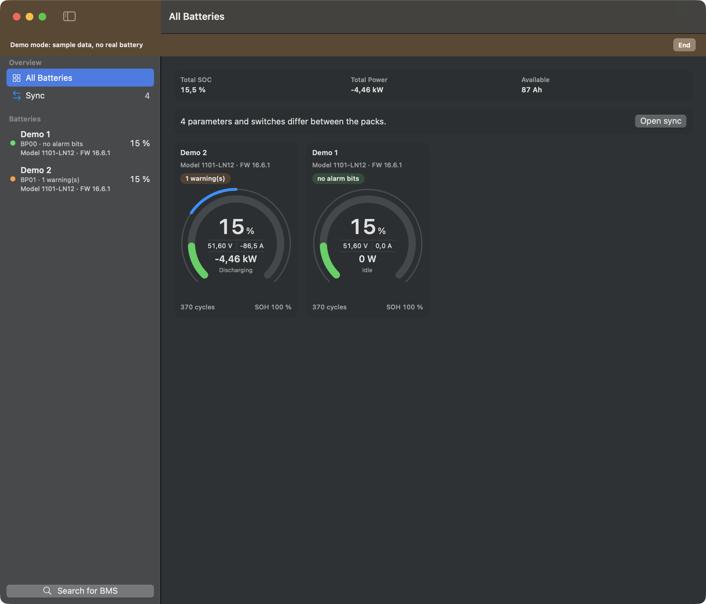

## Contents

1. [Why PackShepherd](#why-packshepherd)
2. [Features](#features)
3. [Supported devices](#supported-devices)
4. [Download](#download)
5. [First steps](#first-steps)
6. [Screenshots](#screenshots)
7. [Safety and known limits](#safety-and-known-limits)
8. [Feedback](#feedback)
9. [Privacy](#privacy)
10. [License](#license)

## Why PackShepherd

I built PackShepherd for three practical reasons:

- The manufacturer's monitor software is cumbersome to use, especially with batteries made of several packs.
- I couldn't find an iOS app that satisfied me.
- Keeping parameters and switches in sync across several packs was tedious.

It's also a learning project. I've worked as a software developer and architect for more than 30 years, mostly on enterprise software, but had no experience with Apple platforms or the iPhone. PackShepherd was my way to learn vibe coding and to test what Claude can do. Claude wrote much of the code.

## Features

- Find all Seplos BMS units nearby automatically and give each pack its own name
- See SOC, voltage, current, power, temperatures, cycles and SOH at a glance
- See every cell voltage, with the highest and lowest cell marked
- Read all parameters and switches and hide the ones you don't need
- Print them or save them as a PDF (Mac and iPhone)
- Change settings in a protected change mode: checks against the firmware's rules, a backup first, and a read-back afterwards
- Compare two or more packs and apply chosen values to them
- See warnings and protection messages from the BMS by name
- Optional password before change mode
- Demo mode to try the app without a battery
- German and English

## Supported devices

| | |
|---|---|
| **BMS** | Seplos BMS 10E with its Bluetooth module (shown as `BP00`, `BP01` and so on) |
| **Tested with** | Firmware 16.6.1 on two packs. Other versions and models may behave differently |
| **Mac** | macOS 14 or later. Tested on Apple silicon. An Intel version is included, but it hasn't been tested yet |
| **Android** | Android 12 or later with Bluetooth. Tested on one phone |
| **iPhone** | iOS 17 or later. Tested on one iPhone |

## Download

| Platform | Get it | Guide |
|---|---|---|
| Mac | [`.dmg` in Releases](../../releases/tag/mac-0.1.1) | [English](docs/mac/UserGuide.md) · [Deutsch](docs/mac/Anleitung.md) |
| Android | [`.apk` in Releases](../../releases/tag/android-0.2.2) | [English](docs/android/UserGuide.md) · [Deutsch](docs/android/Anleitung.md) |
| iPhone | Not available yet | [English](docs/ios/UserGuide.md) · [Deutsch](docs/ios/Anleitung.md) |

Google Play isn't available yet either. Each release lists a SHA-256 checksum, so you can check your download. Changes are listed in the [changelog](CHANGELOG.md).

## First steps

1. Install the app as described in the guide. macOS warns on first start, because the app isn't notarized yet. Android asks you to allow the installation.
2. Close other apps connected to your BMS, for example the manufacturer's app.
3. Start PackShepherd and allow Bluetooth. It finds your packs by itself. No battery at hand? Try the demo mode.

The app only displays values until you activate change mode.

## Screenshots

### Mac

| Dashboard | Cells |
|---|---|
| 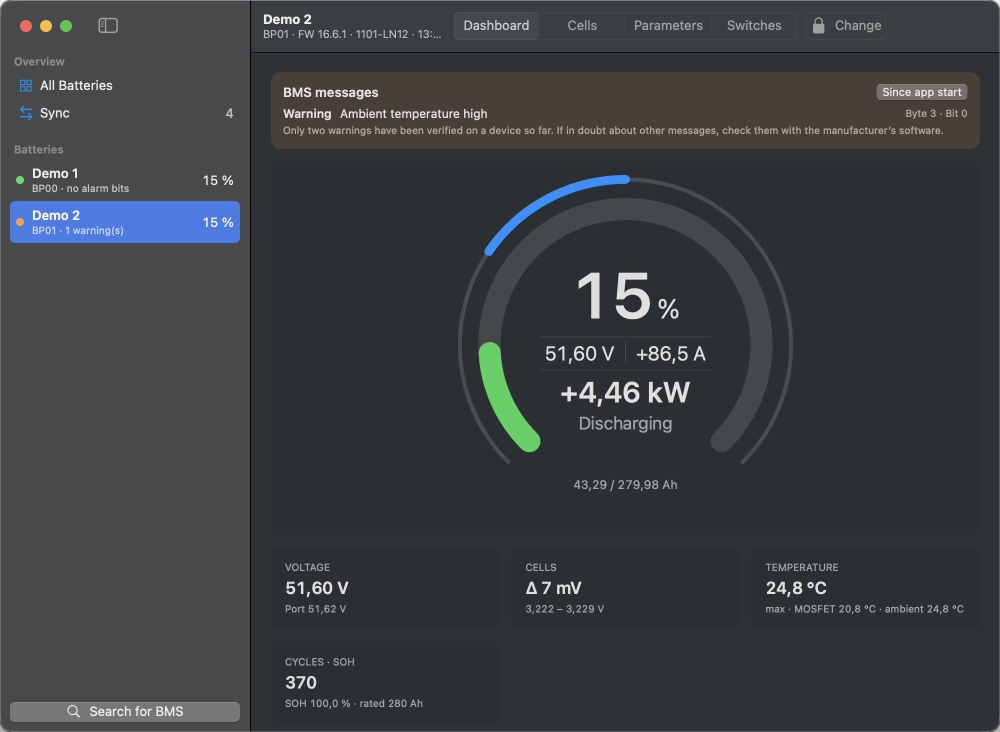 | 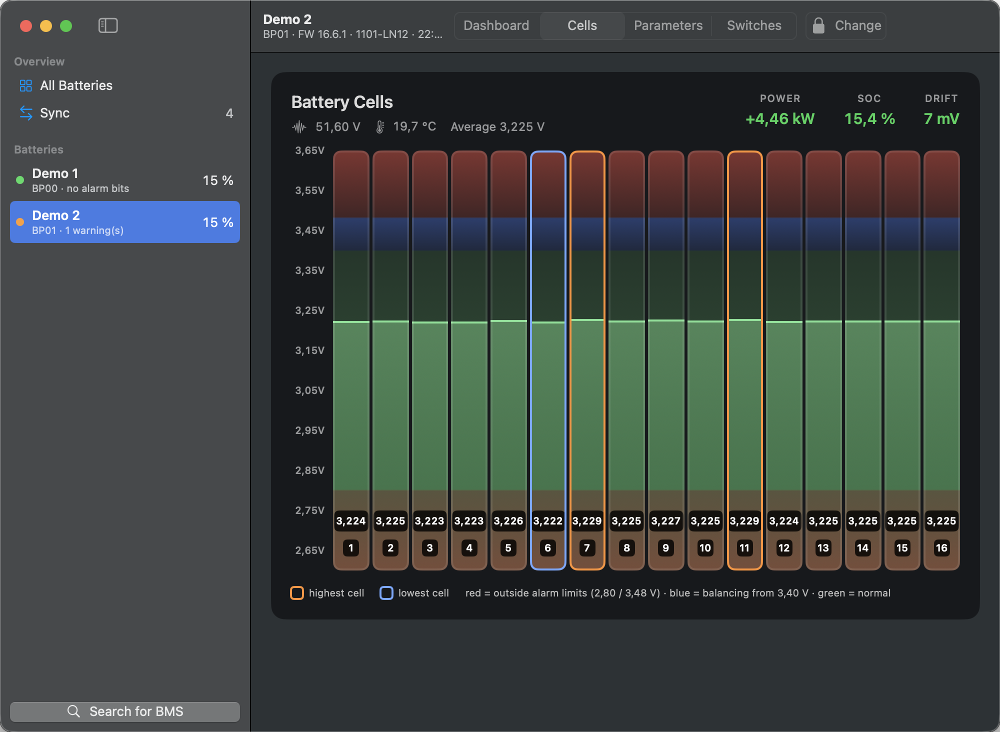 |

| Parameters | Switches |
|---|---|
| 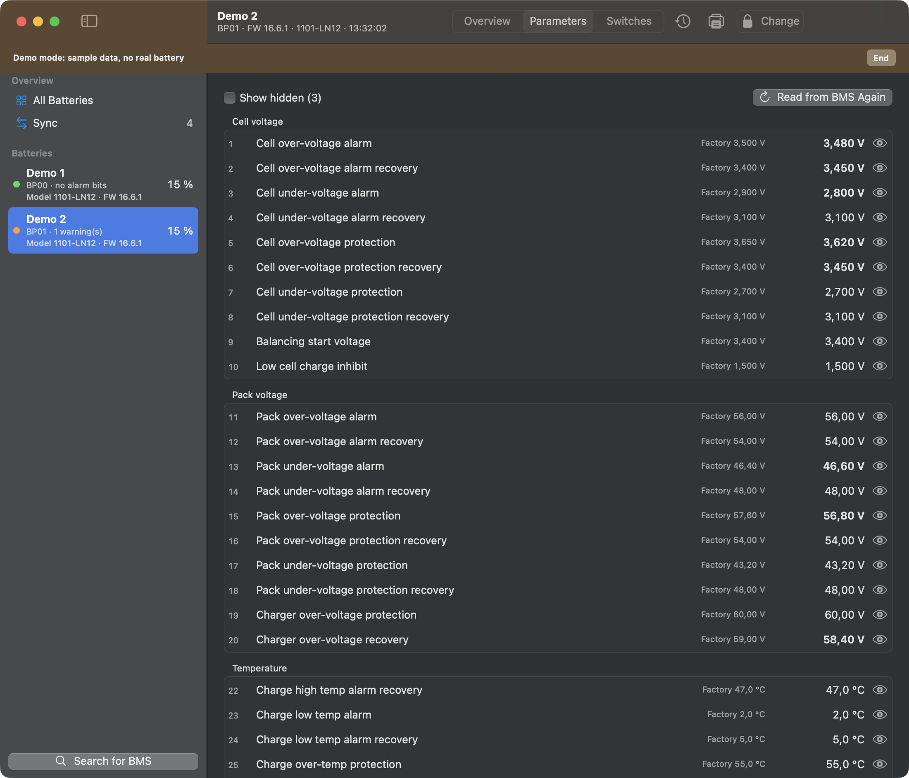 | 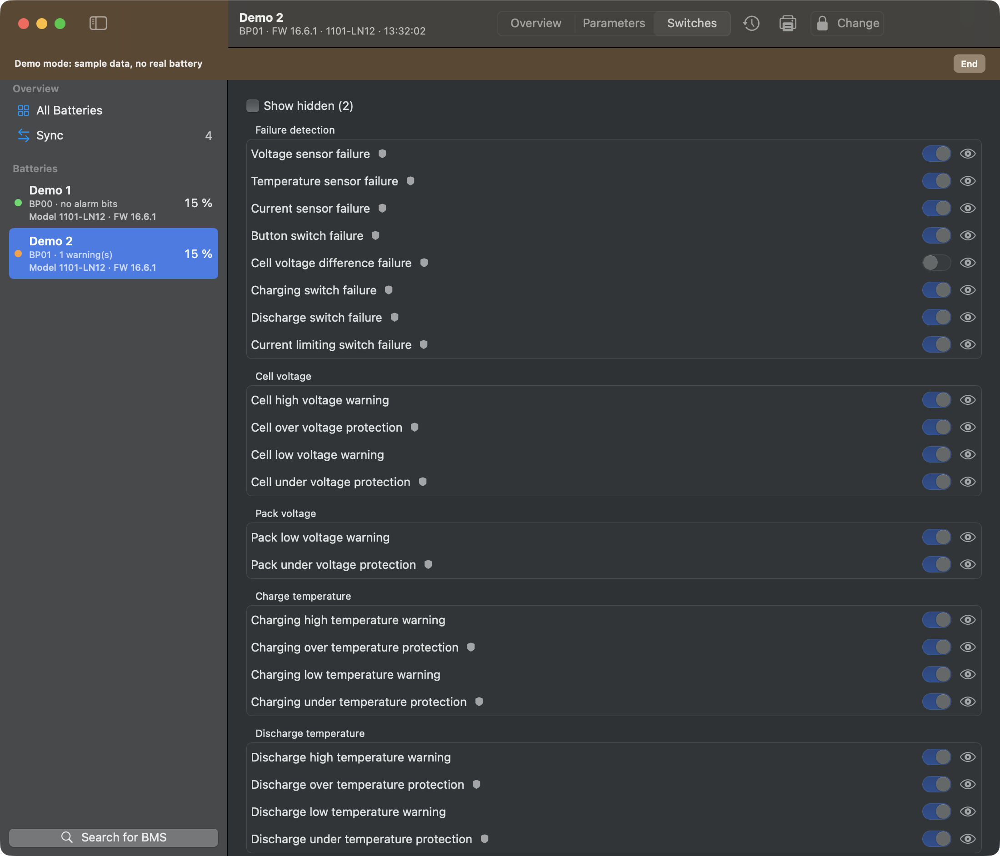 |

**Comparing packs**

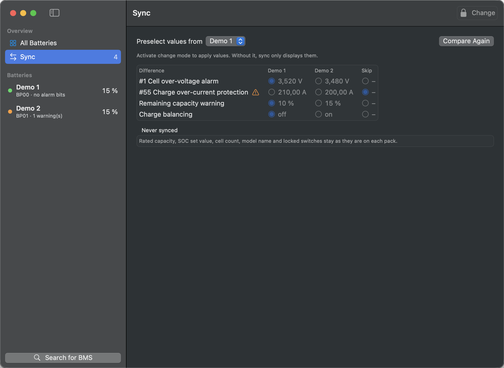

### Android

| Pack list | Dashboard | Cells |
|---|---|---|
| 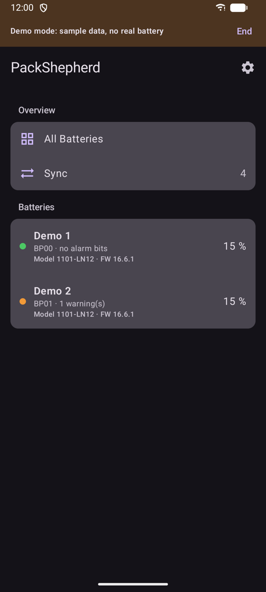 | 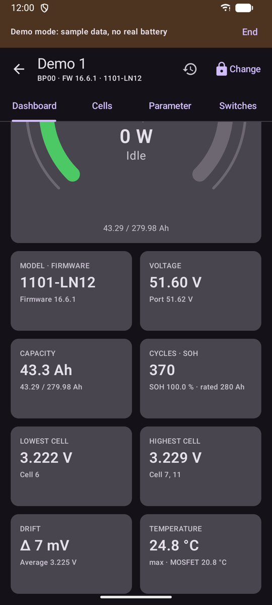 | 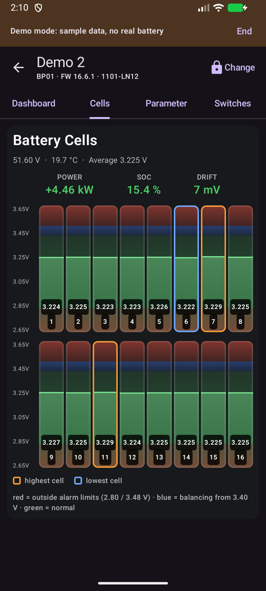 |

| Parameters | Switches | Sync |
|---|---|---|
| 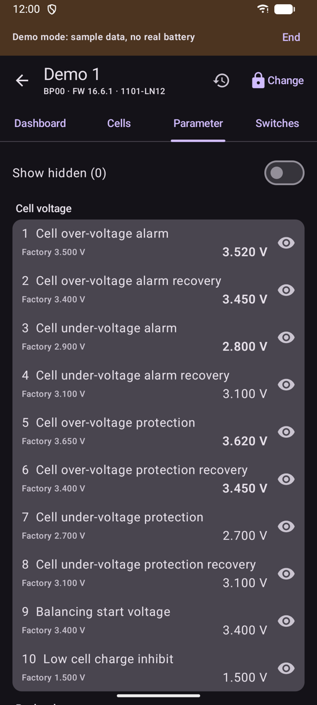 | 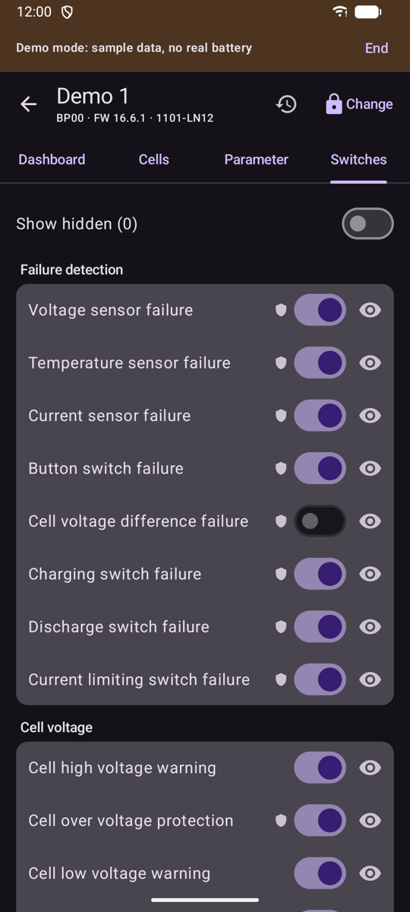 | 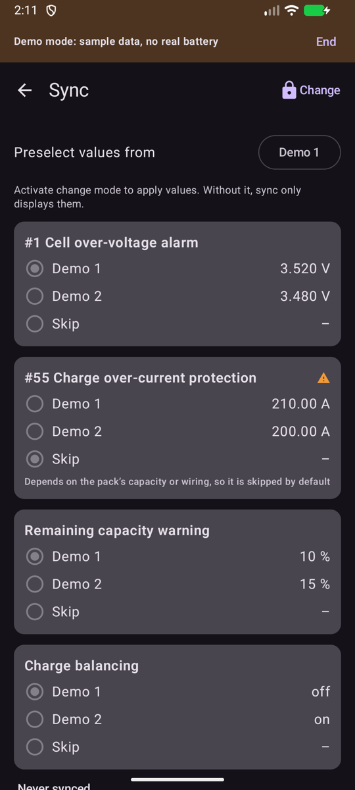 |

### iPhone

| Pack list | Dashboard | Cells |
|---|---|---|
| 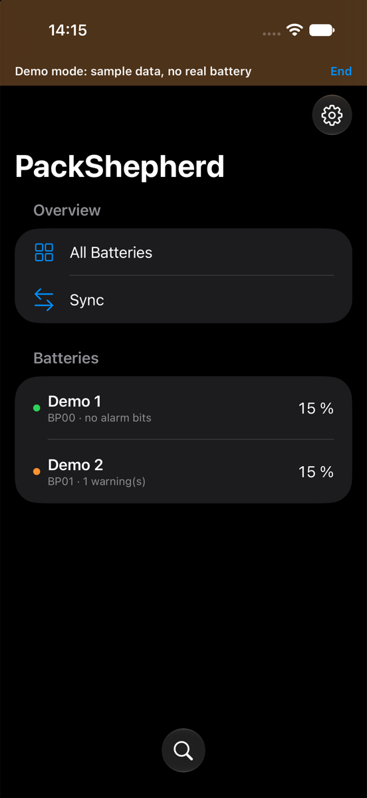 | 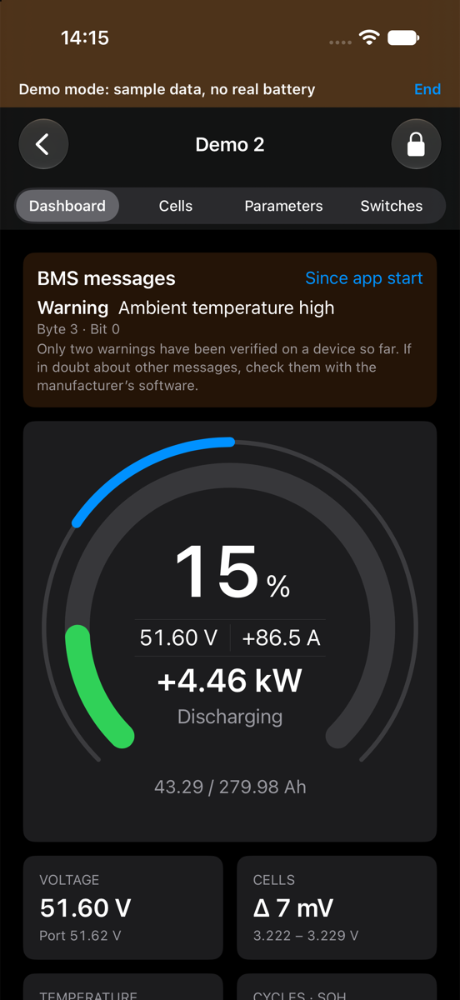 | 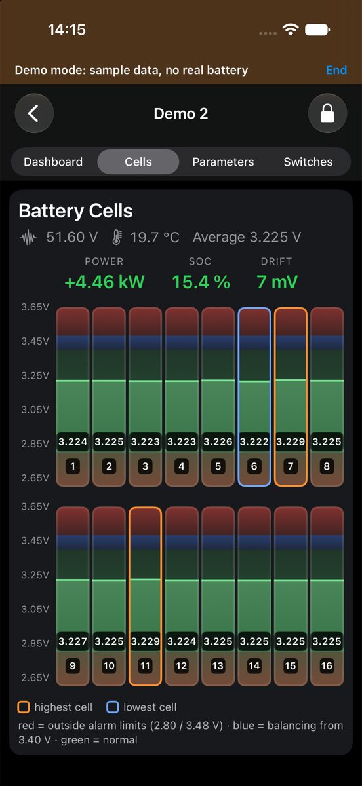 |

| Parameters | Switches | Sync |
|---|---|---|
| 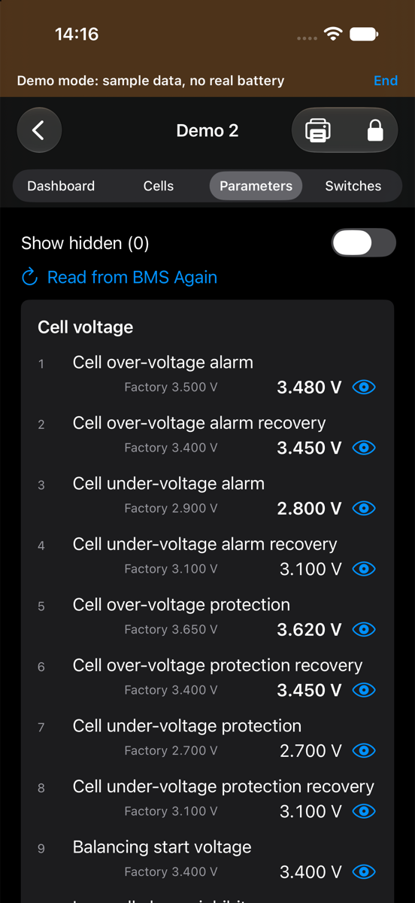 | 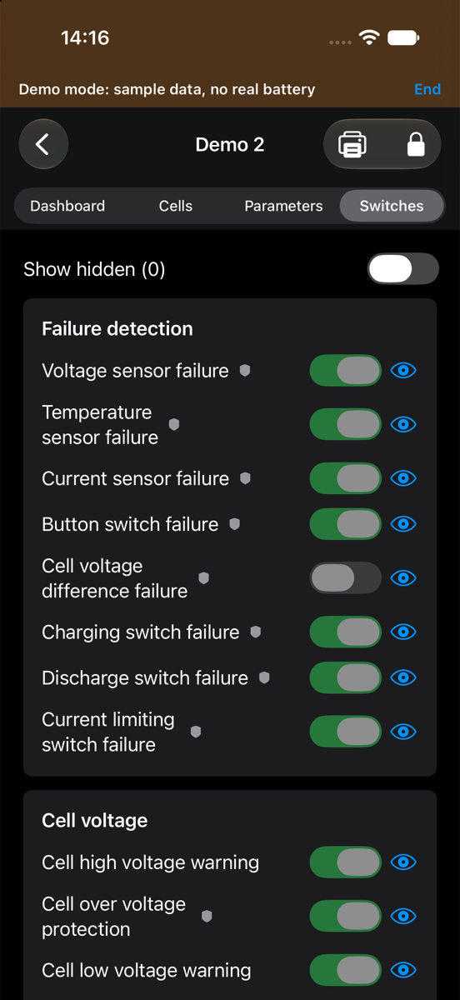 | 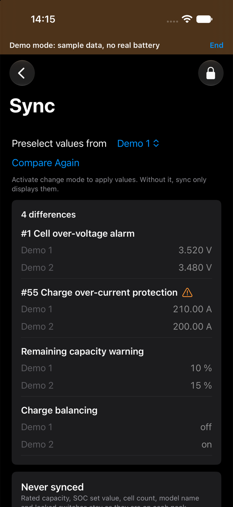 |

## Safety and known limits

- **Only two warnings are verified on a device:** ambient temperature high and discharge temperature high. The other alarm names come from the protocol definition of another tool. If in doubt, check with the manufacturer's software.
- **"No alarm bits set" doesn't mean that everything is fine.** The BMS only reports a warning if its switch is on, and some warnings depend on the direction of the current.
- Live values are shown only while the app runs. There's no history yet.
- The app can save backups, but it can't restore them yet.

## Feedback

Found a bug or have an idea? Open an [issue](../../issues/new/choose). Please include your platform, the app version and the firmware shown in the app. Please test with care: these are early versions.

## Privacy

PackShepherd collects no data and sends nothing over the internet. See the [privacy policy](PRIVACY.md).

## License

PackShepherd is free to use, see [LICENSE](LICENSE). All rights reserved. It uses [SeplosKit](https://github.com/yarc-de/SeplosKit) under the MIT license.

PackShepherd is not a Seplos product and isn't affiliated with Seplos.
