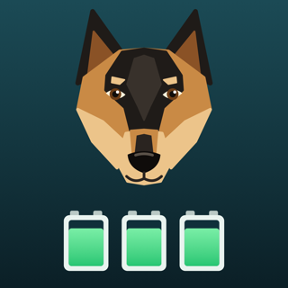
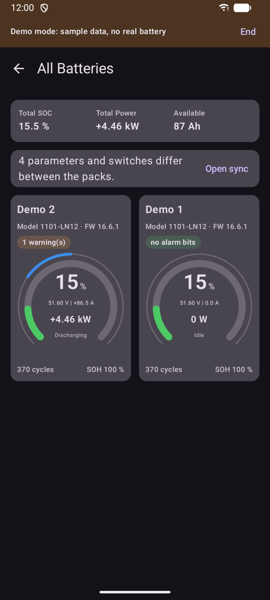
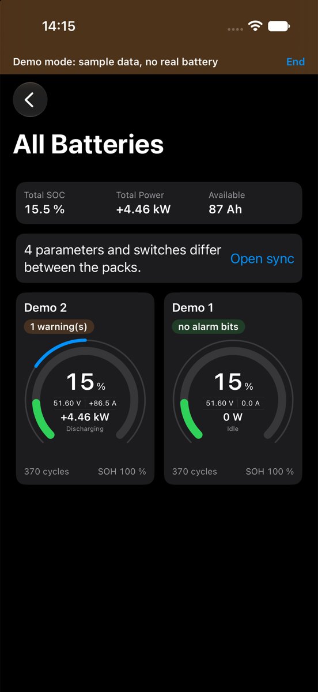

  

<h1 align="center">PackShepherd</h1>

<a href="#deutsche-version">Deutsche Version weiter unten</a>

Monitor and configure **Seplos BMS 10E** battery packs over Bluetooth, on **Android, iPhone and Mac**. The iPhone app isn't available for download yet. A Windows version is planned.

This repository is the home of the project: documentation, downloads, bug reports and ideas. The app is free to use. Its source code isn't public.

> **Warning:** PackShepherd can change the protection settings of a live battery. Wrong settings can damage the battery or become dangerous. Use it at your own risk.

| Android | iPhone | Mac |
|---|---|---|
|  |  |  |

## Contents

1. [Why PackShepherd](#why-packshepherd)
2. [Features](#features)
3. [Supported devices](#supported-devices)
4. [Download](#download)
5. [First steps](#first-steps)
6. [Screenshots](#screenshots)
7. [Safety and known limits](#safety-and-known-limits)
8. [Feedback](#feedback)
9. [Privacy](#privacy)
10. [License](#license)
11. [Deutsche Version](#deutsche-version)

## Why PackShepherd

I built PackShepherd for four practical reasons:

- The manufacturer's monitor software is cumbersome to use, especially with batteries made of several packs.
- Seplos doesn't offer a native Mac version.
- I couldn't find an iOS app that satisfied me.
- Keeping parameters and switches in sync across several packs was tedious.

It's also a learning project. I've worked as a software developer and architect for more than 30 years, mostly on enterprise software, but had no experience developing apps for iOS and Android. PackShepherd was my way to learn vibe coding and to test what Claude can do. Claude wrote much of the code.

## Features

- Find all Seplos BMS units nearby automatically and give each pack its own name
- See SOC, voltage, current, power, temperatures, cycles and SOH at a glance
- See every cell voltage, with the highest and lowest cell marked
- Read all parameters and switches and hide the ones you don't need
- Print them or save them as a PDF (Mac and iPhone)
- Change settings in a protected change mode: checks against the firmware's rules and a read-back afterwards
- Save backups by hand, compare them with the BMS and restore chosen values (Mac from 0.1.3, iPhone and Android with their next version)
- Compare two or more packs and apply chosen values to them
- See warnings and protection messages from the BMS by name
- Optional password before change mode
- Demo mode to try the app without a battery
- German and English

## Supported devices

| | |
|---|---|
| **BMS** | Seplos BMS 10E with its Bluetooth module (shown as `BP00`, `BP01` and so on) |
| **Tested with** | Firmware 16.6.1 on two packs. Other versions and models may behave differently |
| **Mac** | macOS 14 or later. Tested on Apple silicon. An Intel version is included, but it hasn't been tested yet |
| **Android** | Android 12 or later with Bluetooth. Tested on one phone |
| **iPhone** | iOS 17 or later. Tested on one iPhone |

## Download

| Platform | Get it | Guide |
|---|---|---|
| Mac | [`.dmg` in Releases](../../releases/tag/mac-0.1.3) | [English](docs/mac/UserGuide.md) · [Deutsch](docs/mac/Anleitung.md) |
| Android | [`.apk` in Releases](../../releases/tag/android-0.2.2) | [English](docs/android/UserGuide.md) · [Deutsch](docs/android/Anleitung.md) |
| iPhone | Not available yet | [English](docs/ios/UserGuide.md) · [Deutsch](docs/ios/Anleitung.md) |
| Windows | Planned | |

Google Play isn't available yet either. Each release lists a SHA-256 checksum, so you can check your download. Changes are listed in the [changelog](CHANGELOG.md).

## First steps

1. Install the app as described in the guide. macOS warns on first start, because the app isn't notarized yet. Android asks you to allow the installation.
2. Close other apps connected to your BMS, for example the manufacturer's app.
3. Start PackShepherd and allow Bluetooth. It finds your packs by itself. No battery at hand? Try the demo mode.

The app only displays values until you activate change mode.

## Screenshots

### Mac

| Dashboard | Cells |
|---|---|
|  |  |

| Parameters | Switches |
|---|---|
|  |  |

**Comparing packs**

### Android

| Pack list | Dashboard | Cells |
|---|---|---|
|  |  |  |

| Parameters | Switches | Sync |
|---|---|---|
|  |  |  |

### iPhone

| Pack list | Dashboard | Cells |
|---|---|---|
|  |  |  |

| Parameters | Switches | Sync |
|---|---|---|
|  |  |  |

## Safety and known limits

- **Only two warnings are verified on a device:** ambient temperature high and discharge temperature high. The other alarm names come from the protocol definition of another tool. If in doubt, check with the manufacturer's software.
- **"No alarm bits set" doesn't mean that everything is fine.** The BMS only reports a warning if its switch is on, and some warnings depend on the direction of the current.
- Live values are shown only while the app runs. There's no history yet.
- Backups are made only when you choose to. Back up before changing values: the review offers it, and without a backup the old values can't be restored.

## Feedback

Found a bug or have an idea? Open an [issue](../../issues/new/choose). Please include your platform, the app version and the firmware shown in the app. Please test with care: these are early versions.

## Privacy

PackShepherd collects no data and sends nothing over the internet. See the [privacy policy](PRIVACY.md).

## License

PackShepherd is free to use, see [LICENSE](LICENSE). All rights reserved. It uses [SeplosKit](https://github.com/yarc-de/SeplosKit) under the MIT license.

PackShepherd is not a Seplos product and isn't affiliated with Seplos.

---

# Deutsche Version

Überwache und konfiguriere **Seplos-BMS-10E**-Batteriepacks per Bluetooth, auf **Android, iPhone und Mac**. Die iPhone-App lässt sich noch nicht herunterladen. Eine Windows-Version ist geplant.

Dieses Repository ist das Zuhause des Projekts: Dokumentation, Downloads, Fehlermeldungen und Ideen. Die App ist kostenlos. Ihr Quellcode ist nicht öffentlich.

> **Warnung:** PackShepherd kann die Schutzeinstellungen einer laufenden Batterie ändern. Falsche Einstellungen können den Akku beschädigen oder gefährlich werden. Die Nutzung erfolgt auf eigene Verantwortung.

## Warum PackShepherd

Ich habe PackShepherd aus vier praktischen Gründen gebaut:

- Die Monitor-Software des Herstellers ist umständlich zu bedienen, besonders bei Batterien aus mehreren Packs.
- Von Seplos gibt es keine native Mac-Version.
- Ich habe keine iOS-App gefunden, die mich zufriedengestellt hat.
- Parameter und Schalter über mehrere Packs hinweg abzugleichen, war mühsam.

Es ist auch ein Lernprojekt. Ich arbeite seit mehr als 30 Jahren als Softwareentwickler und Architekt, vor allem im Bereich Enterprise-Software, hatte aber keine Erfahrung in der Entwicklung von Apps für iOS und Android. Mit PackShepherd wollte ich Vibe Coding lernen und testen, was Claude kann. Claude hat einen großen Teil des Codes geschrieben.

## Funktionen

- Alle Seplos-BMS in der Nähe automatisch finden und jedem Pack einen eigenen Namen geben
- SOC, Spannung, Strom, Leistung, Temperaturen, Zyklen und SOH auf einen Blick sehen
- Jede Zellspannung sehen, die höchste und die niedrigste Zelle sind markiert
- Alle Parameter und Schalter lesen und ausblenden, was du nicht brauchst
- Sie drucken oder als PDF sichern (Mac und iPhone)
- Einstellungen im geschützten Änderungsmodus ändern: Prüfung gegen die Regeln der Firmware, danach Zurücklesen
- Backups von Hand anlegen, mit dem BMS vergleichen und gewählte Werte zurückspielen (Mac ab 0.1.3, iPhone und Android mit ihrer nächsten Version)
- Zwei oder mehr Packs vergleichen und gewählte Werte übernehmen
- Warnungen und Schutzmeldungen des BMS mit Namen sehen
- Optionales Passwort vor dem Änderungsmodus
- Demo-Modus zum Ausprobieren ohne Batterie
- Deutsch und Englisch

## Unterstützte Geräte

| | |
|---|---|
| **BMS** | Seplos BMS 10E mit Bluetooth-Modul (angezeigt als `BP00`, `BP01` und so weiter) |
| **Getestet mit** | Firmware 16.6.1 an zwei Packs. Andere Versionen und Modelle können sich anders verhalten |
| **Mac** | macOS 14 oder neuer. Getestet auf Apple Silicon. Eine Intel-Version ist enthalten, aber noch nicht getestet |
| **Android** | Android 12 oder neuer mit Bluetooth. Getestet auf einem Telefon |
| **iPhone** | iOS 17 oder neuer. Getestet auf einem iPhone |

## Herunterladen

| Plattform | Bezugsquelle | Anleitung |
|---|---|---|
| Mac | [`.dmg` unter Releases](../../releases/tag/mac-0.1.3) | [Deutsch](docs/mac/Anleitung.md) · [English](docs/mac/UserGuide.md) |
| Android | [`.apk` unter Releases](../../releases/tag/android-0.2.2) | [Deutsch](docs/android/Anleitung.md) · [English](docs/android/UserGuide.md) |
| iPhone | Noch nicht verfügbar | [Deutsch](docs/ios/Anleitung.md) · [English](docs/ios/UserGuide.md) |
| Windows | Geplant | |

Auch bei Google Play ist die App noch nicht verfügbar. Jeder Release nennt eine SHA-256-Prüfsumme, mit der du deinen Download prüfen kannst. Änderungen stehen im [Changelog](CHANGELOG.md).

## Erste Schritte

1. Installiere die App wie in der Anleitung beschrieben. macOS warnt beim ersten Start, weil die App noch nicht notarisiert ist. Android fragt, ob du die Installation erlaubst.
2. Schließe andere Apps, die mit dem BMS verbunden sind, zum Beispiel die App des Herstellers.
3. Starte PackShepherd und erlaube Bluetooth. Die App findet deine Packs von selbst. Keine Batterie zur Hand? Probiere den Demo-Modus aus.

Ohne Änderungsmodus zeigt die App nur an.

Bilder aller Seiten findest du weiter oben unter [Screenshots](#screenshots).

## Sicherheit und bekannte Grenzen

- **Nur zwei Warnungen sind am Gerät bestätigt:** Umgebungstemperatur hoch und Entladetemperatur hoch. Die übrigen Alarmnamen stammen aus der Protokolldefinition eines anderen Werkzeugs. Prüfe sie im Zweifel mit der Software des Herstellers.
- **„Keine Alarmbits gesetzt“ heißt nicht, dass alles in Ordnung ist.** Das BMS meldet eine Warnung nur, wenn ihr Schalter eingeschaltet ist, und manche Warnungen hängen von der Stromrichtung ab.
- Live-Werte erscheinen nur, solange die App läuft. Einen Verlauf gibt es noch nicht.
- Backups entstehen nur, wenn du sie anlegst. Sichere vor dem Ändern: Der Prüfdialog bietet es an, und ohne Backup lassen sich die alten Werte nicht zurückholen.

## Rückmeldungen

Einen Fehler gefunden oder eine Idee? Lege ein [Issue](../../issues/new/choose) an. Nenne bitte deine Plattform, die App-Version und die Firmware aus der App. Bitte teste vorsichtig: Das sind frühe Versionen.

## Datenschutz

PackShepherd erhebt keine Daten und sendet nichts über das Internet. Siehe die [Datenschutzerklärung](PRIVACY.md).

## Lizenz

PackShepherd ist kostenlos nutzbar, siehe [LICENSE](LICENSE) (auf Englisch). Alle Rechte vorbehalten. Die App nutzt [SeplosKit](https://github.com/yarc-de/SeplosKit) unter der MIT-Lizenz.

PackShepherd ist kein Produkt von Seplos und nicht mit Seplos verbunden.
