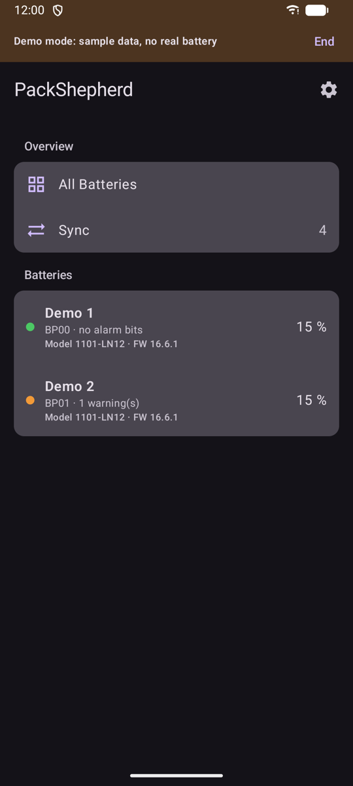
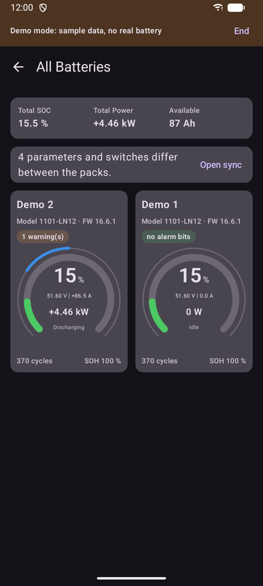
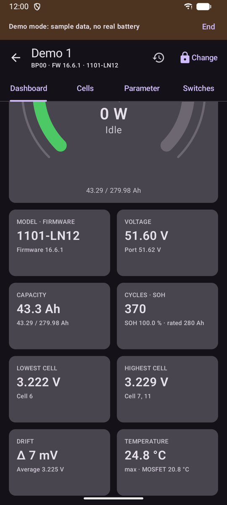
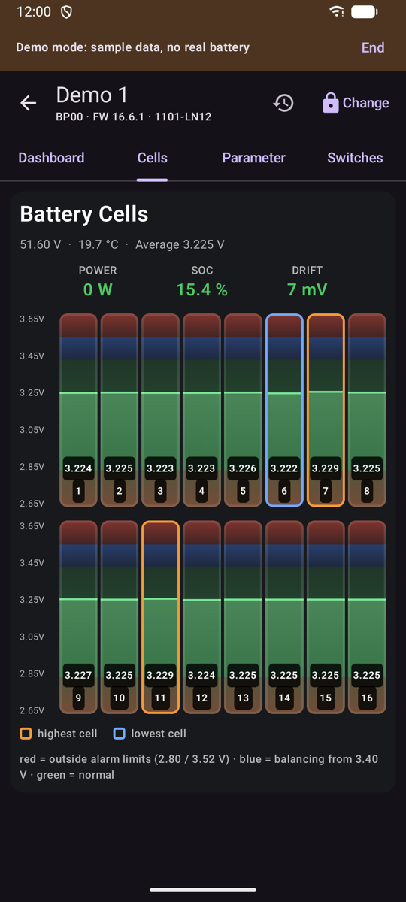
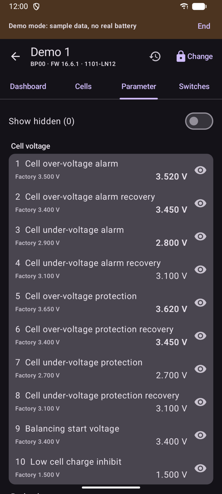
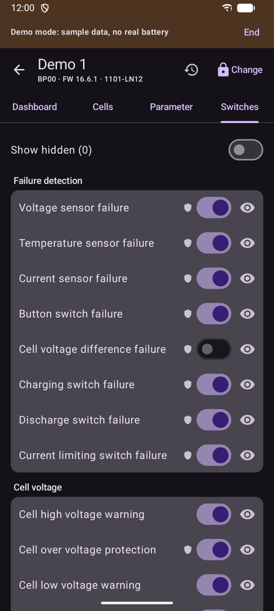
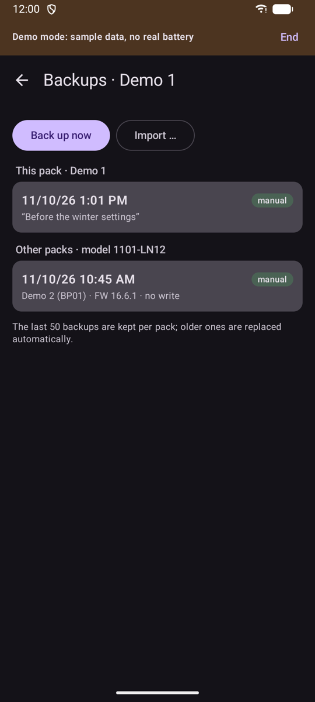
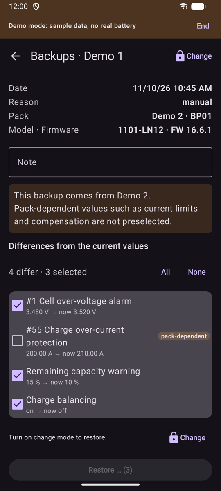
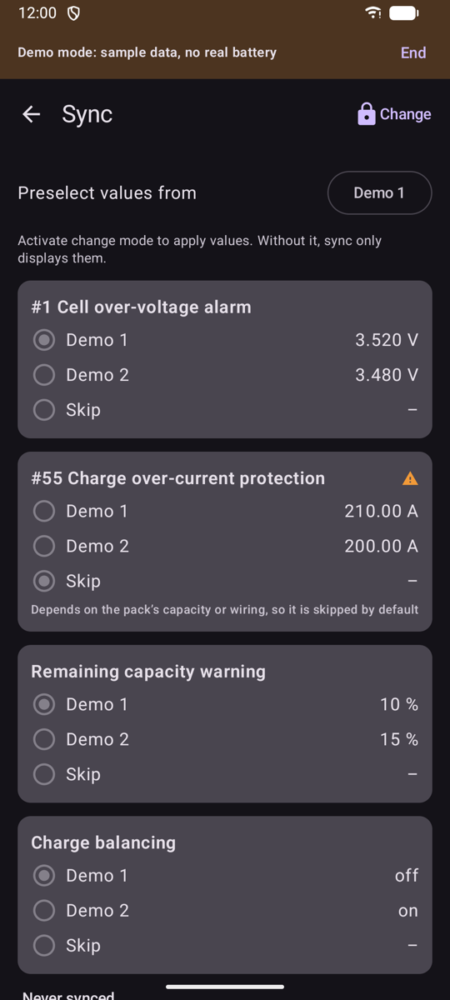

# PackShepherd für Android: Anleitung

## Installieren

PackShepherd ist noch nicht bei Google Play, deshalb installierst du die App selbst. Du brauchst Android 12 oder neuer und Bluetooth.

1. `PackShepherd-<version>.apk` auf dem Telefon unter [Releases](../../../../releases) herunterladen.
2. Optional die SHA-256-Prüfsumme der Datei mit der auf der Release-Seite vergleichen.
3. Die Datei öffnen. Android fragt, ob dein Browser oder deine Datei-App Apps installieren darf. Erlaube das für diese Installation und schalte es danach gern wieder aus.
4. Warnt Google Play Protect vor einer unbekannten App, kannst du trotzdem installieren. Mach das nur bei einer Datei von dieser Seite.
5. PackShepherd starten und **Geräte in der Nähe** erlauben. Die App braucht das für Bluetooth.

Zum Aktualisieren installierst du eine neuere APK über die alte. Deine Einstellungen bleiben erhalten. Wechselst du später zur Version von Google Play, musst du diese womöglich erst deinstallieren. Dabei gehen die Einstellungen und Backups der App verloren.

Lehnst du die Berechtigung ab, zeigt die App Beispiel-Packs. Mit **Beenden** im Hinweis oben fragt sie erneut.

## Verbinden

Schließe alle anderen Apps, die mit dem BMS verbunden sind, auch PackShepherd auf einem anderen Gerät. Ein Modul nimmt nur eine Verbindung an. PackShepherd findet deine Packs dann von selbst. Fehlt eines, wähle unten in der Liste **Nach BMS suchen**.

Die App ist nur verbunden, solange sie auf dem Bildschirm ist. Im Hintergrund trennt sie die Verbindung, damit andere Apps die Module nutzen können, und verbindet sich wieder, wenn du zurückkommst.

Halte ein Pack gedrückt, um es umzubenennen, zu trennen oder aus der Liste zu entfernen. Ein entferntes Pack kommt über die Suche zurück. Am BMS ändert das nichts.

## Übersicht

Ab zwei Packs zeigt **Alle Batterien** die Summen und je Pack eine Karte. Packs mit Meldungen stehen oben. Hat ein Pack die Verbindung verloren, steht das oben auf der Seite, und seine Karte wird blass.

So liest du das Gauge:

- **Ring:** Ladezustand. Er wird orange unter der Warngrenze und rot unter der Schutzgrenze, die im BMS eingestellt sind.
- **Mitte:** Spannung, Strom, Leistung und Richtung.
- **Dünner Bogen außen:** Last. Beim Laden läuft er nach rechts, beim Entladen nach links. Der volle Bogen entspricht der Stromgrenze des BMS.

## Pack-Seiten

- **Dashboard:** Gauge, Meldungen des BMS und wichtige Werte: Modell und Firmware, Spannung, Kapazität, Zyklen, niedrigste und höchste Zelle mit ihren Nummern, Drift und Temperatur.
- **Zellen:** je Zelle eine Säule, höchste und niedrigste Zelle sind markiert.
- **Parameter** und **Schalter:** alle Werte aus dem BMS. Über das Auge blendest du eine Zeile aus. Werte, die vom Werkswert abweichen, sind fett.

Bricht die Verbindung ab, steht das auf jeder Seite, zusammen mit der Uhrzeit der letzten Werte.

## Alarme

Das BMS meldet Alarme als Bits. PackShepherd zeigt sie mit Namen und Position. **Bisher sind nur zwei Warnungen am Gerät bestätigt:** Umgebungstemperatur hoch und Entladetemperatur hoch. Prüfe andere Meldungen im Zweifel mit der Software des Herstellers.

„Keine Alarmbits gesetzt“ heißt nicht, dass alles in Ordnung ist. Das BMS meldet eine Warnung nur, wenn ihr Schalter eingeschaltet ist, und manche Warnungen hängen von der Stromrichtung ab. „Keine Daten“ heißt, dass die App es nicht weiß.

## Einstellungen ändern

> Falsche Einstellungen können den Akku beschädigen oder gefährlich werden. Ändere nur, was du verstehst, und möglichst im Ruhezustand des Packs.

Ohne Änderungsmodus zeigt die App nur an.

1. Ein Pack öffnen und **Ändern** wählen. Beim ersten Mal bestätigst du einen Sicherheitshinweis. Hast du ein Passwort gesetzt, fragt die App danach.
2. Unter **Parameter** oder **Schalter** Werte bearbeiten. Geänderte Felder sind markiert.
3. **Änderungen prüfen** wählen. Die App zeigt alte und neue Werte sowie Werte, die das BMS ablehnen würde. Das Abschalten einer Schutzfunktion braucht eine eigene Bestätigung. Der Prüfdialog zeigt auch dein letztes Backup und bietet **Jetzt sichern** an.
4. **Auf BMS schreiben** wählen. Die App liest die aktuellen Werte, schreibt und vergleicht beim Zurücklesen.

Vor der ersten echten Änderung kannst du **Unverändert schreiben (Verbindungstest)** nutzen. Das schreibt dieselben Werte zurück.

Manche Einstellungen sind gesperrt, weil eine Änderung die Verbindung kappen oder Hardware auslösen könnte.

## Backups

Die App legt Backups nur an, wenn du es willst. Du öffnest sie mit dem Uhr-Knopf auf einer Pack-Seite.

| Backups | Vergleichen und wiederherstellen |
|---|---|
|  |  |

- **Jetzt sichern** speichert alle Parameter und Schalter des Packs.
- Die Liste zeigt die Backups dieses Packs und darunter die anderer Packs mit gleichem Modell.
- Tippst du ein Backup an, siehst du, was vom aktuellen Stand im BMS abweicht. Packabhängige Werte wie Stromgrenzen sind nicht vorausgewählt, gesperrte Werte werden nie zurückgespielt.
- **Wiederherstellen …** braucht den Änderungsmodus und prüft wie beim Schreiben. Ein Backup mit anderer Firmware braucht eine eigene Bestätigung.
- Du kannst eine Notiz ergänzen, ein Backup löschen sowie Backup-Dateien exportieren und importieren, zum Beispiel um sie auf ein anderes Gerät zu bringen. Pro Pack bleiben die letzten 50 Backups.

Backups bleiben im privaten Speicher der App. Beim Deinstallieren werden sie gelöscht, exportiere also die, die du behalten willst.

## Packs abgleichen

**Abgleich** zeigt, was sich zwischen deinen Packs unterscheidet. Ohne Änderungsmodus zeigt die Seite nur an. Im Änderungsmodus:

1. Unter **Werte vorwählen von** das Pack wählen, das die Vorauswahl bestimmt.
2. Je Zeile den gewünschten Wert wählen oder auslassen.
3. **Änderungen prüfen** wählen, jedes Pack kontrollieren und schreiben. Die Packs werden nacheinander geschrieben, und der Prüfdialog bietet an, jedes Pack vorher zu sichern. Beim ersten Fehler stoppt der Vorgang, die Packs können sich danach also weiter unterscheiden.

Alle Packs müssen verbunden sein. Stromgrenzen und Kompensation hängen vom Pack ab und werden nur übernommen, wenn du sie wählst. Unterschiedliche Modelle oder Firmware brauchen eine eigene Bestätigung.

## Einstellungen

Über das Zahnrad in der Pack-Liste findest du Erscheinungsbild, Vorzeichen von Strom und Leistung, Sprache, Passwort und Demo-Modus.

Hast du das Passwort vergessen, lösche den Speicher der App in den Android-Einstellungen. Dabei gehen auch deine Einstellungen, Pack-Namen und Backups verloren.

## Wenn etwas nicht klappt

| Problem | Das hilft |
|---|---|
| „Bluetooth ist aus oder nicht erlaubt“ | Bluetooth einschalten und PackShepherd in den Android-Einstellungen „Geräte in der Nähe“ erlauben |
| Ein Pack wird nicht gefunden | Andere Apps schließen, die mit dem BMS verbunden sind, näher herangehen und erneut suchen |
| „Verbindung fehlgeschlagen – neuer Versuch läuft“ | In der Nähe des Moduls bleiben. Die App versucht es von selbst weiter |
