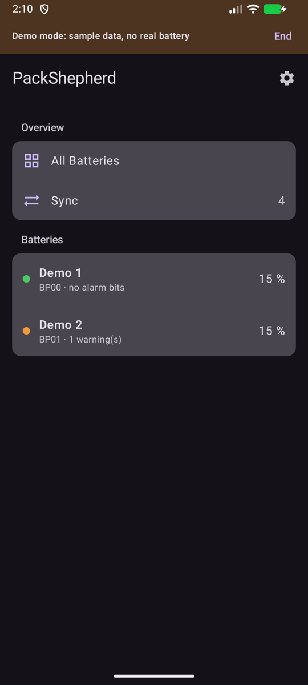
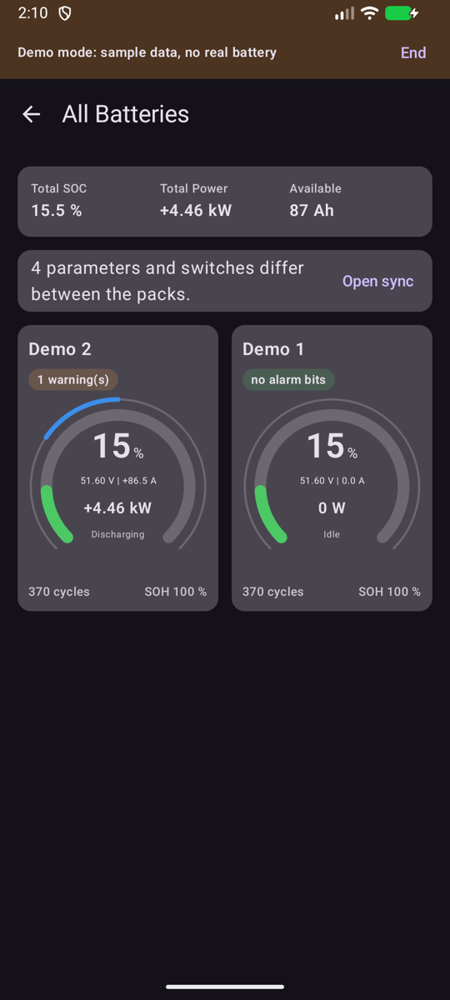
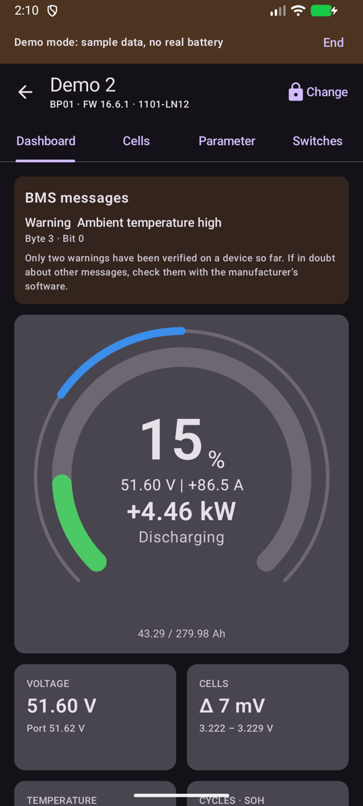
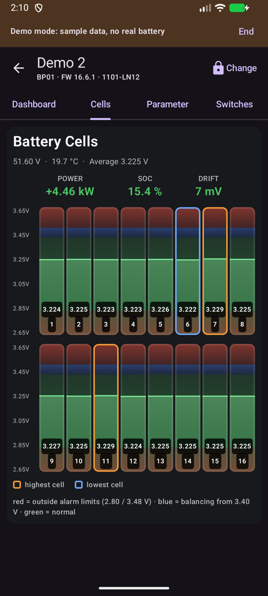
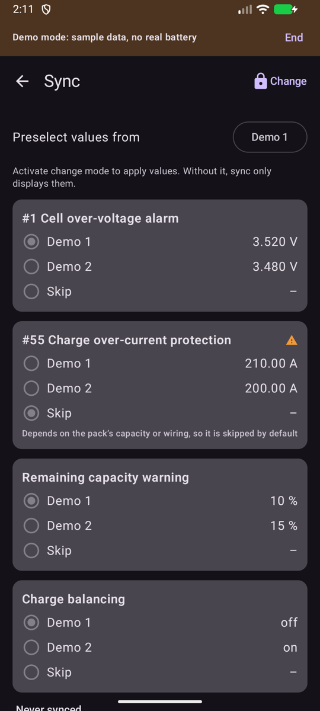

# PackShepherd for Android: user guide

## Install

PackShepherd isn't on Google Play yet, so you install it yourself. You need Android 12 or later and Bluetooth.

1. Download `PackShepherd-<version>.apk` from [Releases](../../../../releases) on your phone.
2. Optional: compare the file's SHA-256 checksum with the one on the release page.
3. Open the file. Android asks whether your browser or file app may install apps. Allow it for this one installation, and turn it off again afterwards if you like.
4. If Google Play Protect warns about an unknown app, you can choose to install anyway. Only do that for a file from this page.
5. Start PackShepherd and allow **Nearby devices**. The app needs this for Bluetooth.

To update, install a newer APK over the old one. Your settings stay. If you later switch to the Google Play version, you may have to uninstall this one first. That deletes the app's settings and backups.

If you refuse the permission, the app shows sample packs. Choose **End** in the banner to ask for it again.

## Connect

Close any other app connected to your BMS, including PackShepherd on another device. A module accepts one connection at a time. PackShepherd then finds your packs by itself. If one is missing, choose **Search for BMS** at the bottom of the list.

The app is only connected while it's on screen. It disconnects in the background, so that other apps can use the modules, and reconnects when you return.

Press and hold a pack to rename it, disconnect it or remove it from the list. A removed pack comes back through the search. Removing it changes nothing on the BMS.

## Overview

With two or more packs, **All Batteries** shows the totals and one card per pack. Packs with a message come first. If a pack has lost its connection, the page says so and its card fades.

Reading the gauge:

- **Ring:** state of charge. It turns orange below the warning limit and red below the protection limit set in the BMS.
- **Center:** voltage, current, power and direction.
- **Thin outer arc:** load. It runs to the right when charging and to the left when discharging. The full arc is the BMS's current limit.

## Pack pages

- **Dashboard:** the gauge, messages from the BMS, and key values.
- **Cells:** one column per cell, with the highest and lowest cell marked.
- **Parameters** and **Switches:** all values from the BMS. Tap the eye to hide a row. Values that differ from the factory value are bold.

If the connection is lost, every page says so and shows when the values were last read.

## Alarms

The BMS reports alarms as bits. PackShepherd shows them by name, with their position. **Only two warnings are verified on a device so far:** ambient temperature high and discharge temperature high. If in doubt about other messages, check with the manufacturer's software.

"No alarm bits set" doesn't mean that everything is fine. The BMS only reports a warning if its switch is on, and some warnings depend on the direction of the current. "No data" means the app can't tell.

## Change settings

> Wrong settings can damage the battery or become dangerous. Only change what you understand, and preferably while the pack is at rest.

The app only displays values until you activate change mode.

1. Open a pack and choose **Change**. The first time, you confirm a safety notice. If you set a password, the app asks for it.
2. Edit the values on **Parameters** or **Switches**. Changed fields are marked.
3. Choose **Review changes**. The app lists old and new values, and shows values the BMS would reject. Turning off a protection function needs a separate confirmation.
4. Choose **Write to BMS**. The app reads the current values, saves a backup, writes, and reads back to compare.

Before the first real change, you can use **Write unchanged (connection test)**. It writes the same values back.

Some settings are locked because changing them could cut the connection or trip hardware.

Backups stay in the app's private storage. You can't open or restore them in this version, and uninstalling the app deletes them.

## Compare and sync packs

**Sync** lists what differs between your packs. It only displays until you activate change mode. Then:

1. Under **Preselect values from**, choose the pack that sets the default.
2. Choose per row which value to use, or skip it.
3. Choose **Review changes**, check each pack and write. Packs are written one at a time, each with a backup. The process stops at the first error, so packs may still differ afterwards.

All packs must be connected. Current limits and compensation depend on the pack, so they are skipped unless you choose them. Different models or firmware need a separate confirmation.

## Settings

Tap the gear on the pack list for appearance, the sign of current and power, language, the password and demo mode.

If you forget the password, clear the app's storage in the Android settings. That also deletes your settings, pack names and backups.

## Troubleshooting

| Problem | Try this |
|---|---|
| "Bluetooth is off or not allowed" | Turn on Bluetooth and allow Nearby devices for PackShepherd in the Android settings |
| A pack isn't found | Close other apps connected to the BMS, move closer, and search again |
| "Connection failed, retrying" | Stay close to the module. The app keeps trying by itself |
