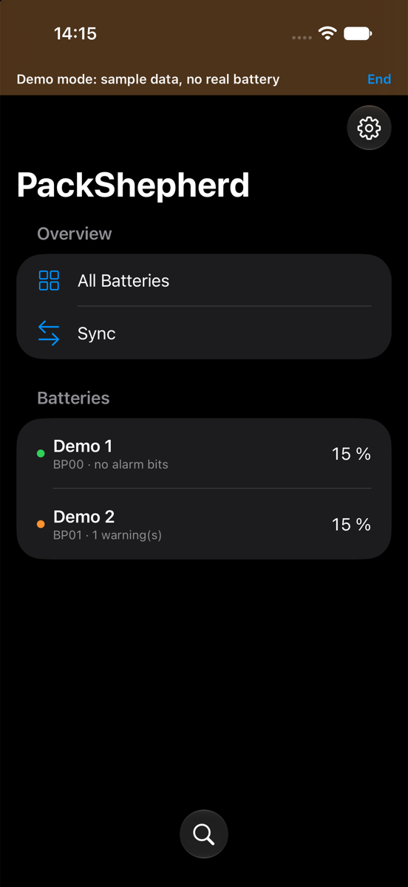
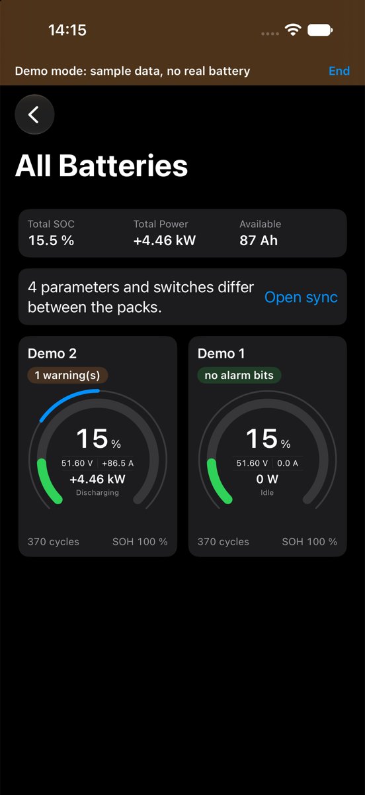
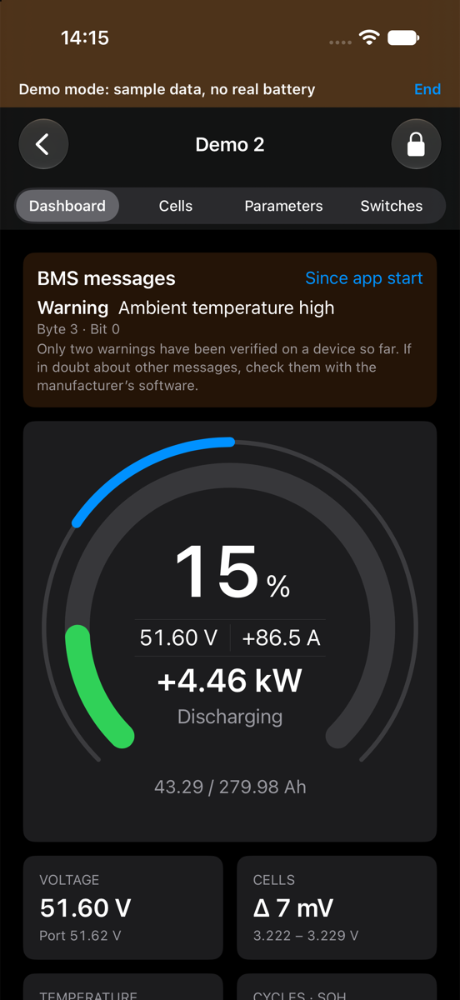
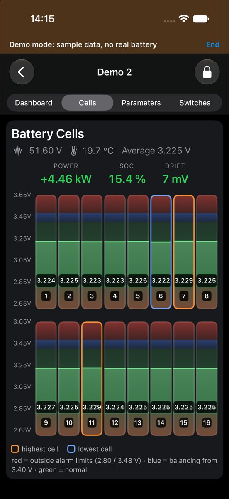
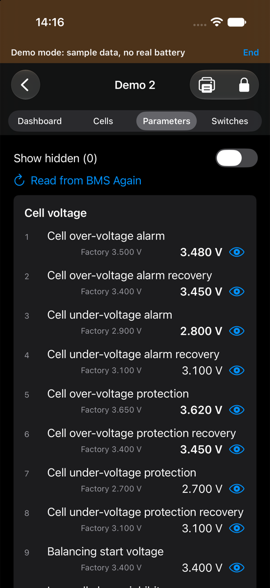
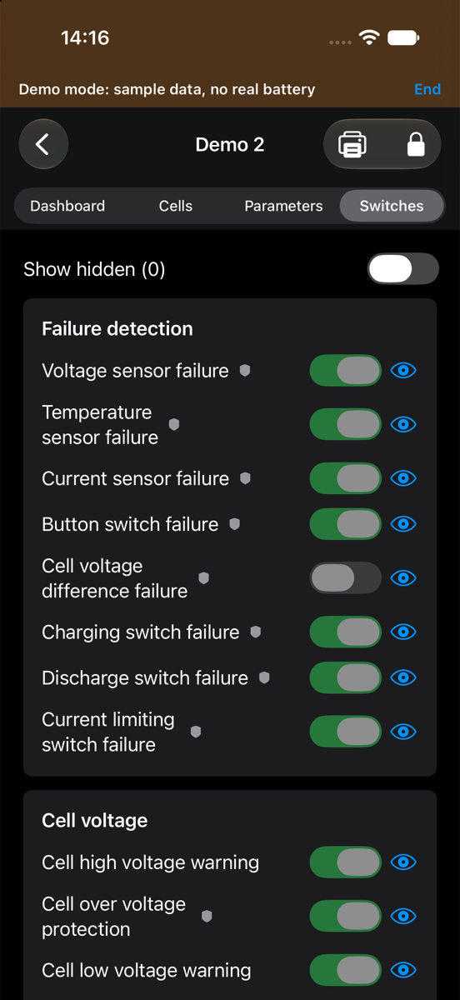
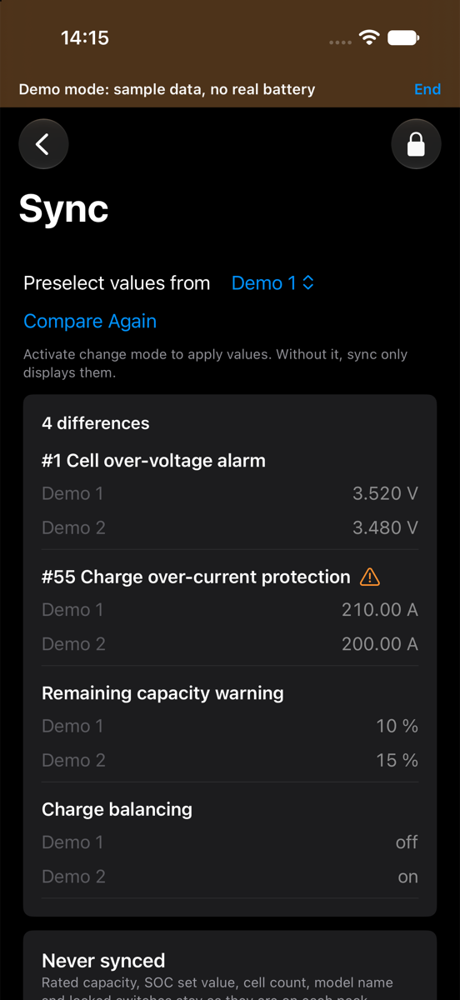

# PackShepherd für iPhone: Anleitung

## App bekommen

Die iPhone-App ist noch nicht verfügbar. Sie kommt über TestFlight oder den App Store, diese Seite sagt dir dann Bescheid. Du brauchst iOS 17 oder neuer.

## Verbinden

Schließe alle anderen Apps, die mit dem BMS verbunden sind, auch PackShepherd auf einem anderen Gerät. Ein Modul nimmt nur eine Verbindung an. Starte PackShepherd und erlaube Bluetooth. Die App findet deine Packs dann von selbst. Fehlt eines, tippe unten in der Liste auf die Lupe.

Wische ein Pack nach links oder halte es gedrückt, um es umzubenennen oder aus der Liste zu entfernen. Ein entferntes Pack kommt über die Suche zurück. Am BMS ändert das nichts.

## Übersicht

Ab zwei Packs zeigt **Alle Batterien** die Summen und je Pack eine Karte. Packs mit Meldungen stehen oben. Hat ein Pack die Verbindung verloren, steht das oben auf der Seite, und seine Karte wird blass.

So liest du das Gauge:

- **Ring:** Ladezustand. Er wird orange unter der Warngrenze und rot unter der Schutzgrenze, die im BMS eingestellt sind.
- **Mitte:** Spannung, Strom, Leistung und Richtung.
- **Dünner Bogen außen:** Last. Beim Laden läuft er nach rechts, beim Entladen nach links. Der volle Bogen entspricht der Stromgrenze des BMS.

## Pack-Seiten

- **Dashboard:** Gauge, Meldungen des BMS und wichtige Werte.
- **Zellen:** je Zelle eine Säule, höchste und niedrigste Zelle sind markiert.
- **Parameter** und **Schalter:** alle Werte aus dem BMS. Über das Auge blendest du eine Zeile aus. Werte, die vom Werkswert abweichen, sind fett. Das Schild markiert eine Schutzfunktion.

Bricht die Verbindung ab, steht das auf jeder Seite, zusammen mit der Uhrzeit der letzten Werte.

## Alarme

Das BMS meldet Alarme als Bits. PackShepherd zeigt sie mit Namen und Position. **Bisher sind nur zwei Warnungen am Gerät bestätigt:** Umgebungstemperatur hoch und Entladetemperatur hoch. Prüfe andere Meldungen im Zweifel mit der Software des Herstellers.

„Keine Alarmbits gesetzt“ heißt nicht, dass alles in Ordnung ist. Das BMS meldet eine Warnung nur, wenn ihr Schalter eingeschaltet ist, und manche Warnungen hängen von der Stromrichtung ab. „Keine Daten“ heißt, dass die App es nicht weiß.

## Einstellungen ändern

> Falsche Einstellungen können den Akku beschädigen oder gefährlich werden. Ändere nur, was du verstehst, und möglichst im Ruhezustand des Packs.

Ohne Änderungsmodus zeigt die App nur an.

1. Ein Pack öffnen und auf das Schloss tippen. Beim ersten Mal bestätigst du einen Sicherheitshinweis. Hast du ein Passwort gesetzt, fragt die App danach.
2. Unter **Parameter** oder **Schalter** Werte bearbeiten. Geänderte Felder sind markiert.
3. Auf **Änderungen prüfen** tippen. Die App zeigt alte und neue Werte sowie Werte, die das BMS ablehnen würde. Das Abschalten einer Schutzfunktion braucht eine eigene Bestätigung.
4. Auf **Auf BMS schreiben** tippen. Die App liest die aktuellen Werte, legt ein Backup an, schreibt und vergleicht beim Zurücklesen.

Vor der ersten echten Änderung kannst du **Mehr › Unverändert schreiben (Verbindungstest)** nutzen. Das schreibt dieselben Werte zurück.

Manche Einstellungen sind gesperrt, weil eine Änderung die Verbindung kappen oder Hardware auslösen könnte.

Backups bleiben im privaten Speicher der App. In dieser Version kannst du sie weder öffnen noch wiederherstellen, und beim Löschen der App werden sie gelöscht.

## Packs abgleichen

**Abgleich** zeigt, was sich zwischen deinen Packs unterscheidet. Ohne Änderungsmodus zeigt die Seite nur an. Im Änderungsmodus:

1. Unter **Werte vorwählen von** das Pack wählen, das die Vorauswahl bestimmt.
2. Je Zeile den gewünschten Wert wählen oder auslassen.
3. Auf **Änderungen prüfen** tippen, jedes Pack kontrollieren und schreiben. Die Packs werden nacheinander geschrieben, jeweils mit Backup. Beim ersten Fehler stoppt der Vorgang, die Packs können sich danach also weiter unterscheiden.

Alle Packs müssen verbunden sein. Nennkapazität, SOC-Setzwert, Zellenanzahl, Modellname und gesperrte Schalter werden nie abgeglichen. Stromgrenzen und Kompensation hängen vom Pack ab und werden nur übernommen, wenn du sie wählst. Unterschiedliche Modelle oder Firmware brauchen eine eigene Bestätigung.

## Drucken

Auf der Seite Parameter oder Schalter auf den Drucker tippen. Der Bericht enthält nur die zuletzt vom BMS gelesenen Werte, keine nicht geschriebenen Änderungen.

## Einstellungen

Über das Zahnrad in der Pack-Liste findest du Erscheinungsbild, Vorzeichen von Strom und Leistung, Passwort und Demo-Modus, außerdem **Über PackShepherd** und die Datenschutzerklärung. Der Demo-Modus zeigt Beispiel-Packs und verbindet sich mit keinem BMS. Über den Hinweis oben verlässt du ihn wieder.

Hast du das Passwort vergessen, lösche die App und installiere sie neu. Dabei gehen auch deine Einstellungen, Pack-Namen und Backups verloren.

## Wenn etwas nicht klappt

| Problem | Das hilft |
|---|---|
| „Bluetooth ist aus oder nicht erlaubt“ | Bluetooth einschalten und PackShepherd in den iOS-Einstellungen unter Datenschutz & Sicherheit › Bluetooth erlauben |
| Ein Pack wird nicht gefunden | Andere Apps schließen, die mit dem BMS verbunden sind, näher herangehen und erneut suchen |
| „Vergleich unvollständig“ | Alle Packs verbinden und dann „Neu vergleichen“ wählen |
