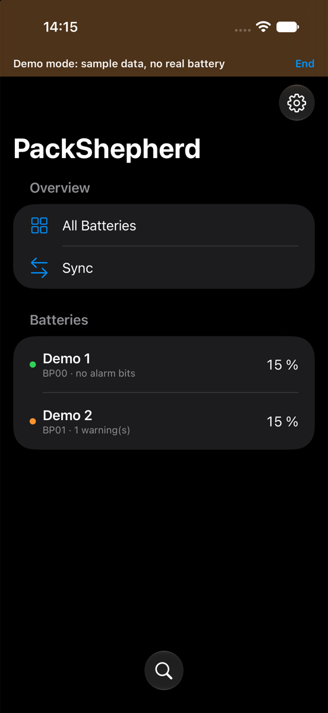
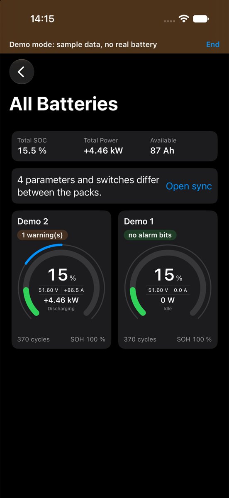
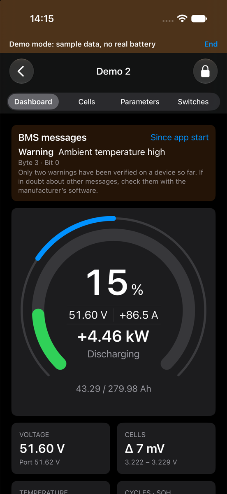
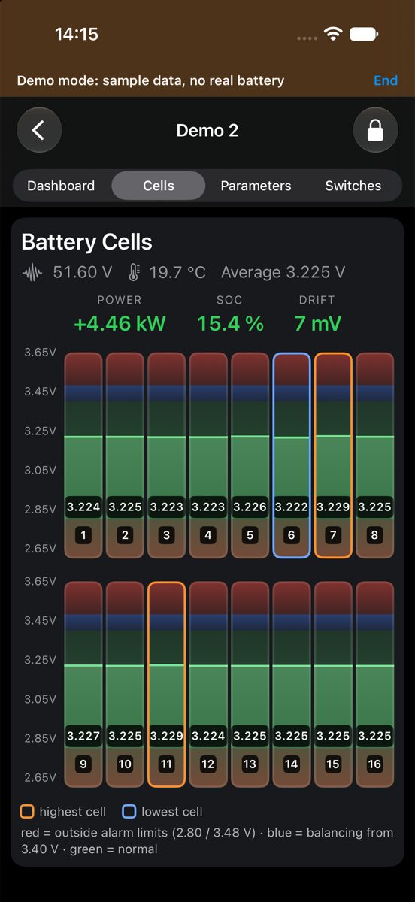
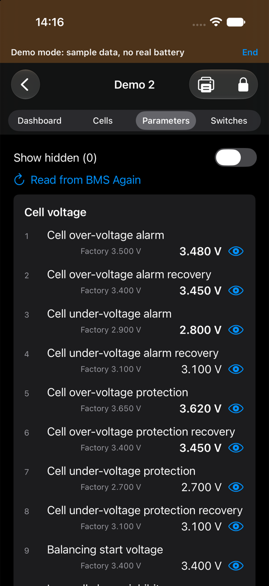
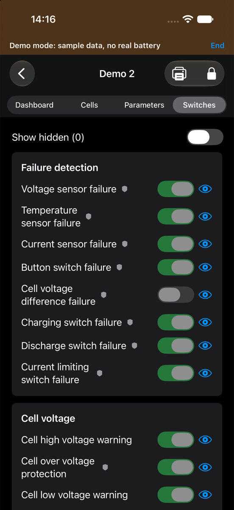
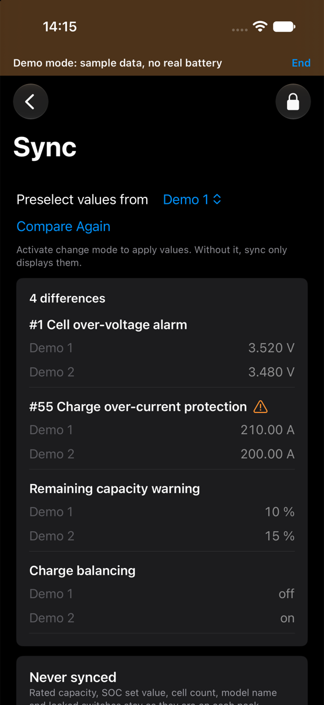

# PackShepherd for iPhone: user guide

## Get the app

The iPhone app isn't available yet. It will come through TestFlight or the App Store, and this page will say when. You'll need iOS 17 or later.

## Connect

Close any other app connected to your BMS, including PackShepherd on another device. A module accepts one connection at a time. Start PackShepherd and allow Bluetooth. It then finds your packs by itself. If one is missing, tap the magnifying glass at the bottom of the list.

Swipe left on a pack, or press and hold it, to rename it or remove it from the list. A removed pack comes back through the search. Removing it changes nothing on the BMS.

## Overview

With two or more packs, **All Batteries** shows the totals and one card per pack. Packs with a message come first. If a pack has lost its connection, the page says so and its card fades.

Reading the gauge:

- **Ring:** state of charge. It turns orange below the warning limit and red below the protection limit set in the BMS.
- **Center:** voltage, current, power and direction.
- **Thin outer arc:** load. It runs to the right when charging and to the left when discharging. The full arc is the BMS's current limit.

## Pack pages

- **Dashboard:** the gauge, messages from the BMS, and key values.
- **Cells:** one column per cell, with the highest and lowest cell marked.
- **Parameters** and **Switches:** all values from the BMS. Tap the eye to hide a row. Values that differ from the factory value are bold. The shield marks a protection function.

If the connection is lost, every page says so and shows when the values were last read.

## Alarms

The BMS reports alarms as bits. PackShepherd shows them by name, with their position. **Only two warnings are verified on a device so far:** ambient temperature high and discharge temperature high. If in doubt about other messages, check with the manufacturer's software.

"No alarm bits set" doesn't mean that everything is fine. The BMS only reports a warning if its switch is on, and some warnings depend on the direction of the current. "No data" means the app can't tell.

## Change settings

> Wrong settings can damage the battery or become dangerous. Only change what you understand, and preferably while the pack is at rest.

The app only displays values until you activate change mode.

1. Open a pack and tap the lock. The first time, you confirm a safety notice. If you set a password, the app asks for it.
2. Edit the values on **Parameters** or **Switches**. Changed fields are marked.
3. Tap **Review changes**. The app lists old and new values, and shows values the BMS would reject. Turning off a protection function needs a separate confirmation.
4. Tap **Write to BMS**. The app reads the current values, saves a backup, writes, and reads back to compare.

Before the first real change, you can use **More › Write unchanged (connection test)**. It writes the same values back.

Some settings are locked because changing them could cut the connection or trip hardware.

Backups stay in the app's private storage. You can't open or restore them in this version, and deleting the app deletes them.

## Compare and sync packs

**Sync** lists what differs between your packs. It only displays until you activate change mode. Then:

1. Under **Preselect values from**, choose the pack that sets the default.
2. Choose per row which value to use, or skip it.
3. Tap **Review changes**, check each pack and write. Packs are written one at a time, each with a backup. The process stops at the first error, so packs may still differ afterwards.

All packs must be connected. Rated capacity, SOC set value, cell count, model name and locked switches are never synced. Current limits and compensation depend on the pack, so they are skipped unless you choose them. Different models or firmware need a separate confirmation.

## Print

On the Parameters or Switches page, tap the printer. The report contains only values last read from the BMS, not unwritten changes.

## Settings

Tap the gear on the pack list for appearance, the sign of current and power, the password and demo mode. **About PackShepherd** and the privacy policy are there too. Demo mode shows sample packs and doesn't connect to a BMS, and the banner at the top lets you leave it.

If you forget the password, delete and reinstall the app. That also deletes your settings, pack names and backups.

## Troubleshooting

| Problem | Try this |
|---|---|
| "Bluetooth is off or not allowed" | Turn on Bluetooth and allow PackShepherd in iOS Settings under Privacy & Security › Bluetooth |
| A pack isn't found | Close other apps connected to the BMS, move closer, and search again |
| "Comparison incomplete" | Connect all packs, then choose Compare Again |
