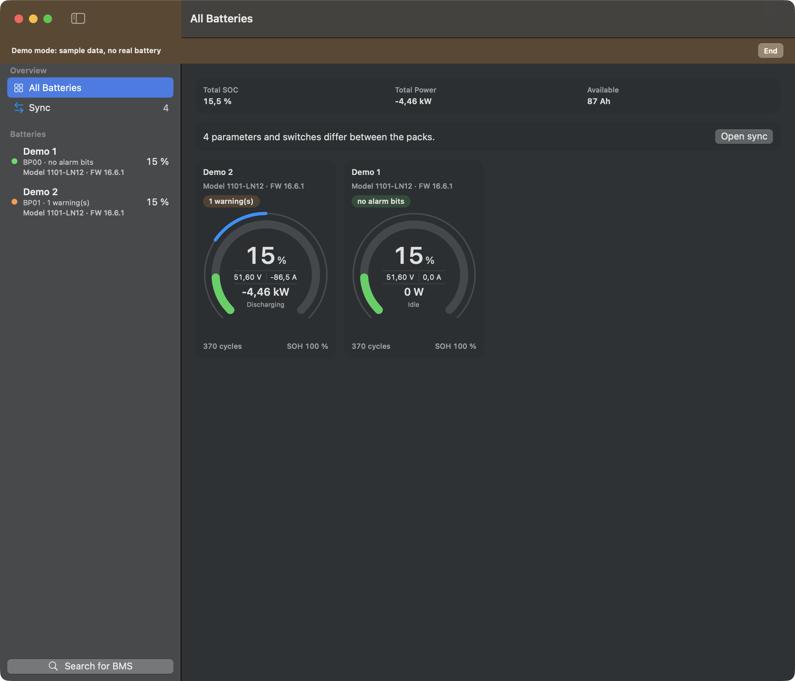
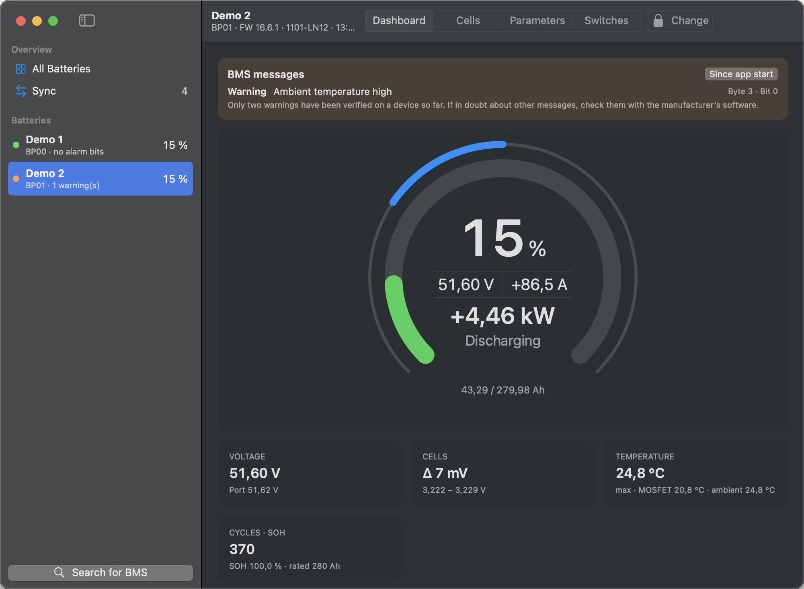
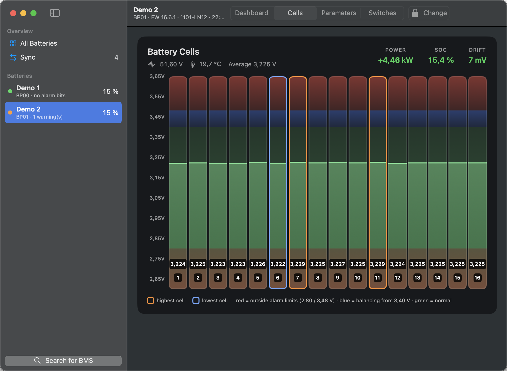
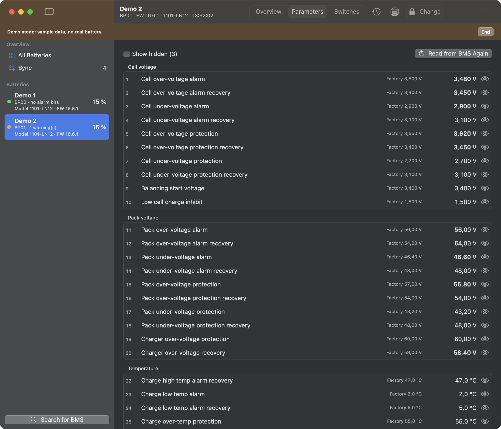
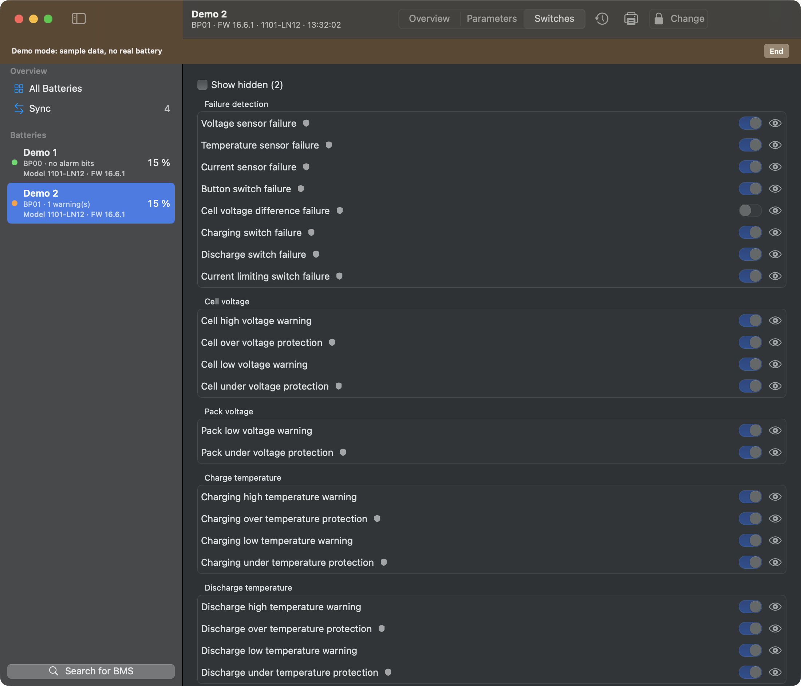
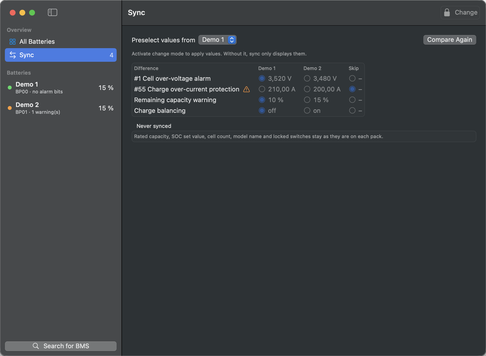

# PackShepherd-Anleitung

## Installieren

1. `PackShepherd-<version>.dmg` unter [Releases](../../../../releases) herunterladen.
2. Optional den Download im Terminal prüfen. Das Ergebnis muss mit der `.sha256`-Datei auf der Release-Seite übereinstimmen.

   ```bash
   shasum -a 256 ~/Downloads/PackShepherd-*.dmg
   ```

3. Die `.dmg` öffnen und PackShepherd auf „Applications“ ziehen.
4. PackShepherd starten. macOS blockiert die App beim ersten Mal, weil sie noch nicht notarisiert ist:
   - Systemeinstellungen › Datenschutz & Sicherheit öffnen.
   - Nach unten zum Hinweis auf PackShepherd scrollen und **Dennoch öffnen** wählen.
5. Bluetooth erlauben, wenn macOS fragt.

## Verbinden

Schließe alle anderen Apps, die mit dem BMS verbunden sind, zum Beispiel die Hersteller-App auf dem Handy. PackShepherd findet deine Packs dann von selbst. Fehlt eines, wähle unten in der Seitenleiste **Nach BMS suchen**.

Per Rechtsklick auf ein Pack kannst du es umbenennen, trennen oder aus der Liste entfernen. Ein entferntes Pack kommt über die Suche zurück. Am BMS ändert das nichts.

## Übersicht



Ab zwei Packs zeigt **Alle Batterien** die Summen und je Pack eine Karte. Ein Klick auf die Karte öffnet das Pack. Packs mit Meldungen stehen oben.

So liest du das Gauge:

- **Ring:** Ladezustand. Er wird orange unter der Warngrenze und rot unter der Schutzgrenze, die im BMS eingestellt sind.
- **Mitte:** Spannung, Strom, Leistung und Richtung.
- **Dünner Bogen außen:** Last. Beim Laden läuft er nach rechts, beim Entladen nach links. Der volle Bogen entspricht der Stromgrenze des BMS.

Die Ringfarbe zeigt nur den Ladezustand. Alarme erscheinen getrennt als Text.

## Pack-Seiten



- **Dashboard:** Gauge, Meldungen des BMS und wichtige Werte.
- **Zellen:** je Zelle eine Säule, höchste und niedrigste Zelle sind markiert.
- **Parameter** und **Schalter:** alle Werte aus dem BMS. Über das Auge blendest du eine Zeile aus.





„Werk“ zeigt den Werkswert, davon abweichende Werte sind fett.



Das Schild markiert eine Schutzfunktion.

## Alarme

Das BMS meldet Alarme als Bits. PackShepherd zeigt sie mit Namen und Position. **Bisher sind nur zwei Warnungen am Gerät bestätigt:** Umgebungstemperatur hoch und Entladetemperatur hoch. Prüfe andere Meldungen im Zweifel mit der Software des Herstellers.

„Keine Alarmbits gesetzt“ heißt nicht, dass alles in Ordnung ist. Das BMS meldet eine Warnung nur, wenn ihr Schalter eingeschaltet ist, und manche Warnungen hängen von der Stromrichtung ab: Im Test erschien die Warnung für die Ladetemperatur beim Entladen nicht. „Keine Daten“ heißt, dass die App es nicht weiß.

## Einstellungen ändern

> Falsche Einstellungen können den Akku beschädigen oder gefährlich werden. Ändere nur, was du verstehst, und möglichst im Ruhezustand des Packs.

Ohne Änderungsmodus zeigt die App nur an.

1. **Parameter** oder **Schalter** öffnen und **Ändern** wählen. Beim ersten Mal bestätigst du einen Sicherheitshinweis. Hast du ein Passwort gesetzt, fragt die App danach.
2. Werte bearbeiten. Geänderte Felder sind markiert.
3. **Änderungen prüfen** wählen. Die App zeigt alte und neue Werte sowie Werte, die das BMS ablehnen würde. Das Abschalten einer Schutzfunktion braucht eine eigene Bestätigung.
4. **Auf BMS schreiben** wählen. Die App liest die aktuellen Werte, legt ein Backup an, schreibt und vergleicht beim Zurücklesen.

Manche Einstellungen sind gesperrt, weil eine Änderung die Verbindung kappen oder Hardware auslösen könnte: Zellenanzahl, SOC-Setzwert, Sekundärauslösung, LCD, Bluetooth, Adressvergabe und externe Abfrage.

Backups sind JSON-Dateien. Ihren Ordner öffnest du über Batterie › Backups im Finder zeigen. Wiederherstellen kann die App sie noch nicht.

## Packs abgleichen



**Abgleich** zeigt, was sich zwischen deinen Packs unterscheidet. Ohne Änderungsmodus zeigt die Seite nur an. Im Änderungsmodus:

1. Unter **Werte vorwählen von** das Pack wählen, das die Vorauswahl bestimmt.
2. Je Zeile den gewünschten Wert wählen oder auslassen.
3. **Änderungen prüfen** wählen, jedes Pack kontrollieren und schreiben. Die Packs werden nacheinander geschrieben, jeweils mit Backup. Beim ersten Fehler stoppt der Vorgang, die Packs können sich danach also weiter unterscheiden.

Nennkapazität, SOC-Setzwert, Zellenanzahl, Modellname und gesperrte Schalter werden nie abgeglichen. Stromgrenzen und Kompensation hängen vom Pack ab und werden nur übernommen, wenn du sie wählst. Unterschiedliche Modelle oder Firmware brauchen eine eigene Bestätigung.

## Drucken

Auf der Seite Parameter oder Schalter das Druckersymbol anklicken oder Ablage › Drucken (⌘P) wählen. Im Druckdialog lässt sich auch ein PDF sichern. Der Bericht enthält nur die zuletzt vom BMS gelesenen Werte, keine nicht geschriebenen Änderungen.

## Einstellungen

Unter PackShepherd › Einstellungen (⌘,) findest du Erscheinungsbild, Sprache, Vorzeichen von Strom und Leistung und das Passwort. Hast du das Passwort vergessen, entfernst du es im Terminal:

```bash
defaults delete de.yarc.packshepherd editPassword
```

## Demo ausprobieren

Du kannst die App ohne Batterie ausprobieren. Schalte dazu in den Einstellungen den **Demo-Modus** ein, oder wähle **Demo ansehen**, solange kein Pack in der Liste steht. Die App trennt dann deine Packs und zeigt zwei Beispiel-Packs mit einem Hinweis oben im Fenster. Sie verbindet sich dabei mit keinem BMS und schreibt nichts. Mit **Beenden** im Hinweis kehrst du zu deinen Packs zurück.

## Wenn etwas nicht klappt

| Problem | Das hilft |
|---|---|
| „Bluetooth ist aus oder nicht erlaubt“ | Bluetooth einschalten und PackShepherd unter Systemeinstellungen › Datenschutz & Sicherheit › Bluetooth erlauben |
| Ein Pack wird nicht gefunden | Andere Apps schließen, die mit dem BMS verbunden sind, näher herangehen und erneut suchen |
| „Vergleich unvollständig“ | Alle Packs verbinden und dann „Neu vergleichen“ wählen |
