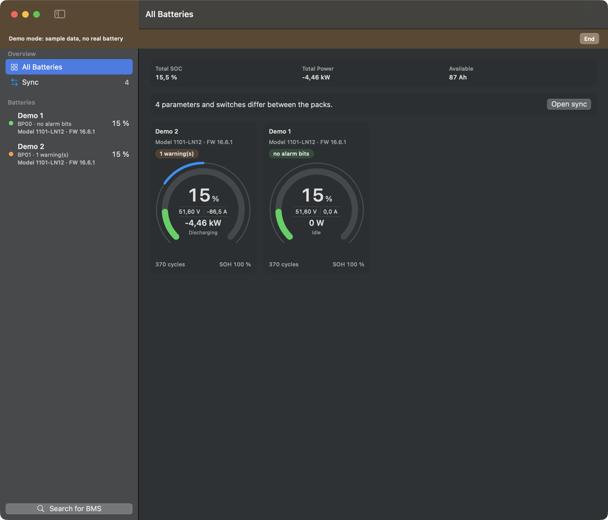
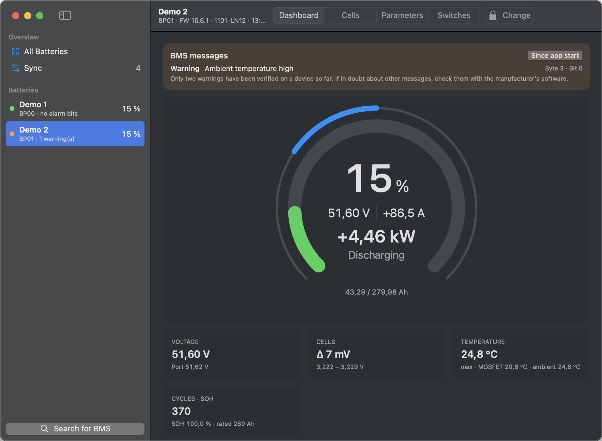
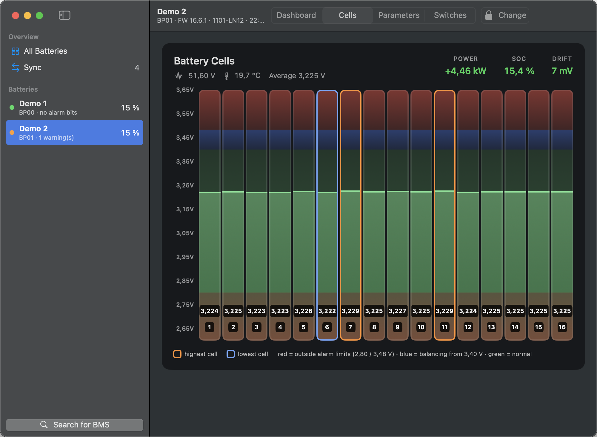
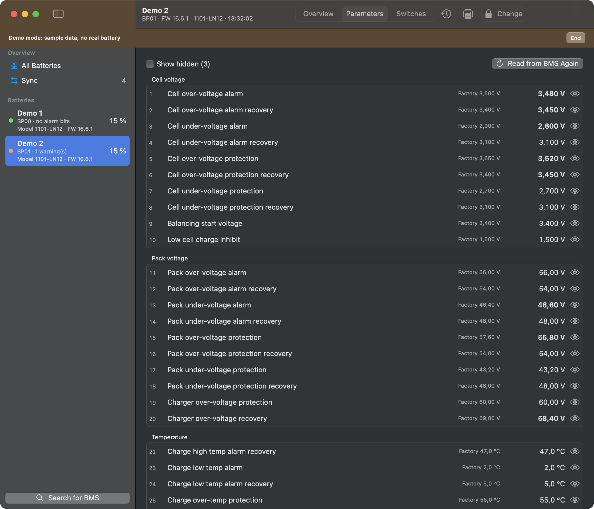
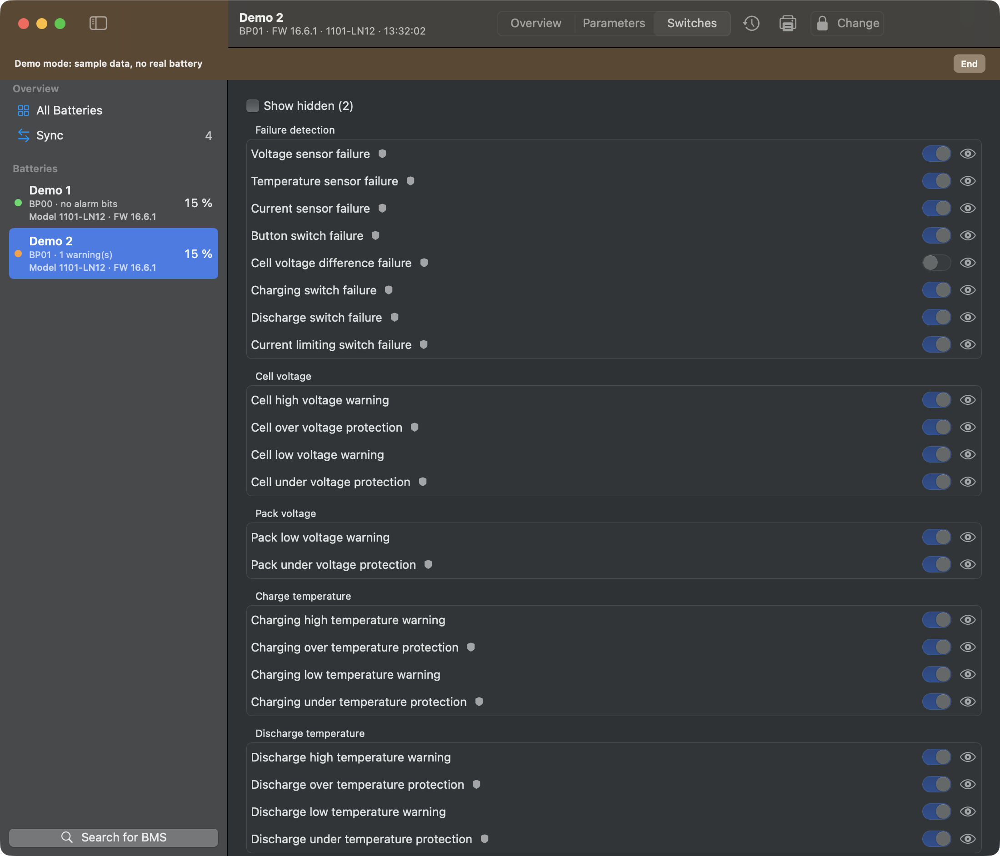
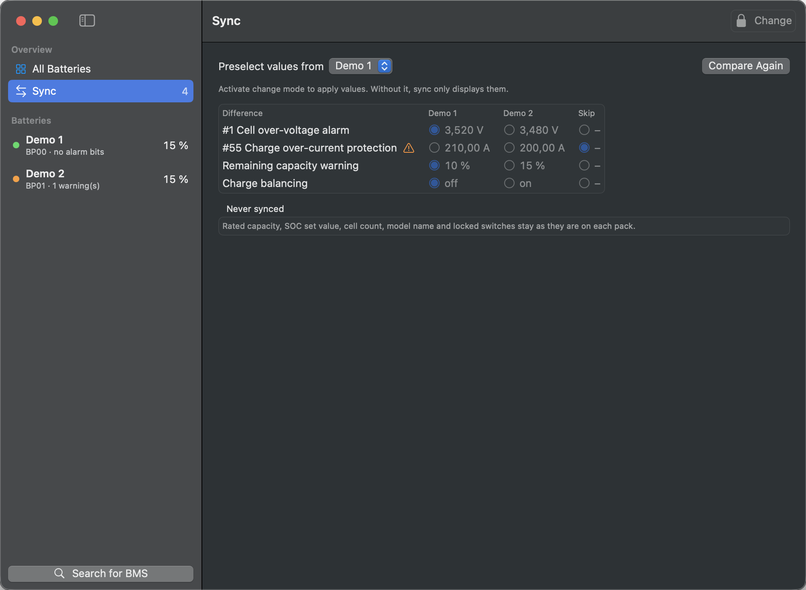

# PackShepherd user guide

## Install

1. Download `PackShepherd-<version>.dmg` from [Releases](../../../../releases).
2. Optional: check the download in Terminal. The result must match the `.sha256` file on the release page.

   ```bash
   shasum -a 256 ~/Downloads/PackShepherd-*.dmg
   ```

3. Open the `.dmg` and drag PackShepherd onto Applications.
4. Start PackShepherd. macOS blocks it the first time, because the app isn't notarized yet:
   - Open System Settings › Privacy & Security.
   - Scroll down to the note about PackShepherd and choose **Open Anyway**.
5. Allow Bluetooth when macOS asks.

## Connect

Close any other app that is connected to your BMS, for example the manufacturer's app on your phone. PackShepherd then finds your packs by itself. If one is missing, choose **Search for BMS** at the bottom of the sidebar.

Right-click a pack to rename it, disconnect it or remove it from the list. A removed pack comes back through the search. Removing it changes nothing on the BMS.

## Overview



With two or more packs, **All Batteries** shows the totals and one card per pack. Click a card to open the pack. Packs with a message come first.

Reading the gauge:

- **Ring:** state of charge. It turns orange below the warning limit and red below the protection limit set in the BMS.
- **Center:** voltage, current, power and direction.
- **Thin outer arc:** load. It runs to the right when charging and to the left when discharging. The full arc is the BMS's current limit.

The ring color shows only the state of charge. Alarms appear separately as text.

## Pack pages



- **Dashboard:** the gauge, messages from the BMS, and key values.
- **Cells:** one column per cell, with the highest and lowest cell marked.
- **Parameters** and **Switches:** all values from the BMS. Click the eye to hide a row.





"Factory" shows the factory value, and values that differ from it are bold.



The shield marks a protection function.

## Alarms

The BMS reports alarms as bits. PackShepherd shows them by name, with their position. **Only two warnings are verified on a device so far:** ambient temperature high and discharge temperature high. If in doubt about other messages, check with the manufacturer's software.

"No alarm bits set" doesn't mean that everything is fine. The BMS only reports a warning if its switch is on, and some warnings depend on the direction of the current: in our test, the charge temperature warning didn't appear while discharging. "No data" means the app can't tell.

## Change settings

> Wrong settings can damage the battery or become dangerous. Only change what you understand, and preferably while the pack is at rest.

The app only displays values until you activate change mode.

1. Open **Parameters** or **Switches** and choose **Change**. The first time, you confirm a safety notice. If you set a password, the app asks for it.
2. Edit the values. Changed fields are marked.
3. Choose **Review changes**. The app lists old and new values, and shows values the BMS would reject. Turning off a protection function needs a separate confirmation.
4. Choose **Write to BMS**. The app reads the current values, saves a backup, writes, and reads back to compare.

Some settings are locked because changing them could cut the connection or trip hardware: cell count, SOC set value, secondary trip, LCD, Bluetooth, address coding and external polling.

Backups are JSON files. Open their folder with Battery › Show Backups in Finder. The app can't restore them yet.

## Compare and sync packs



**Sync** lists what differs between your packs. It only displays until you activate change mode. Then:

1. Under **Preselect values from**, choose the pack that sets the default.
2. Choose per row which value to use, or skip it.
3. Choose **Review changes**, check each pack and write. Packs are written one at a time, each with a backup. The process stops at the first error, so packs may still differ afterwards.

Rated capacity, SOC set value, cell count, model name and locked switches are never synced. Current limits and compensation depend on the pack, so they are skipped unless you choose them. Different models or firmware need a separate confirmation.

## Print

On the Parameters or Switches page, click the printer icon or choose File › Print (⌘P). The print dialog can also save a PDF. The report contains only values last read from the BMS, not unwritten changes.

## Settings

Open PackShepherd › Settings (⌘,) for appearance, language, the sign of current and power, and the password. If you forget the password, remove it in Terminal:

```bash
defaults delete de.yarc.packshepherd editPassword
```

## Try the demo

You can try the app without a battery. Turn on **Demo mode** in the settings, or choose **Try the demo** while no pack is listed. The app then disconnects from your packs and shows two sample packs, with a banner at the top. It doesn't connect to a BMS and writes nothing. Choose **End** in the banner to go back to your packs.

## Troubleshooting

| Problem | Try this |
|---|---|
| "Bluetooth is off or not allowed" | Turn on Bluetooth and allow PackShepherd under System Settings › Privacy & Security › Bluetooth |
| A pack isn't found | Close other apps connected to the BMS, move closer, and search again |
| "Comparison incomplete" | Connect all packs, then choose Compare Again |
